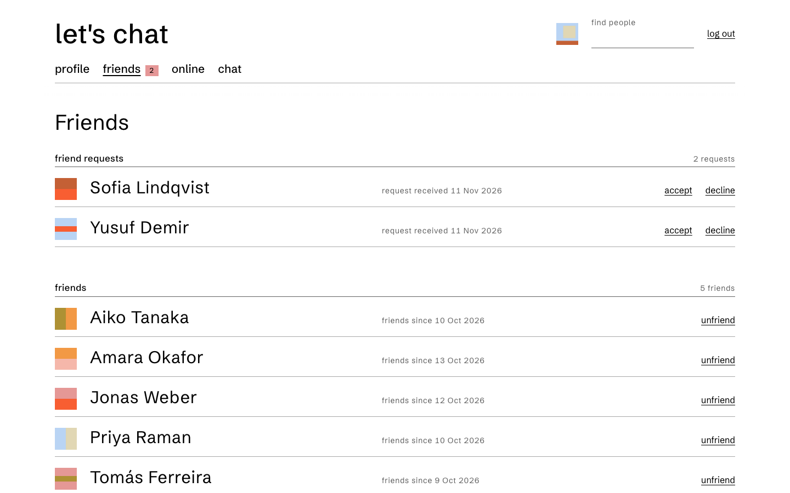
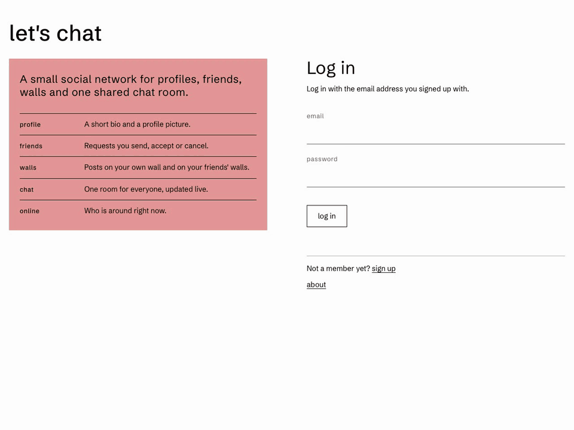
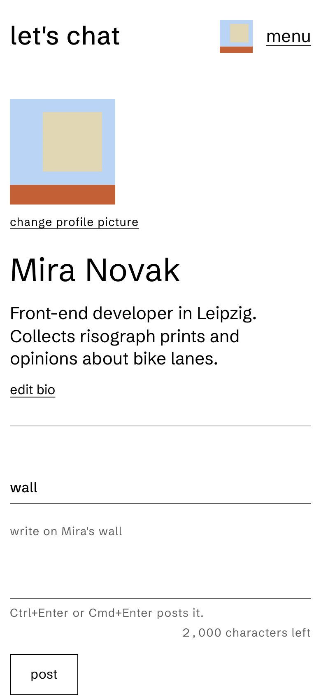
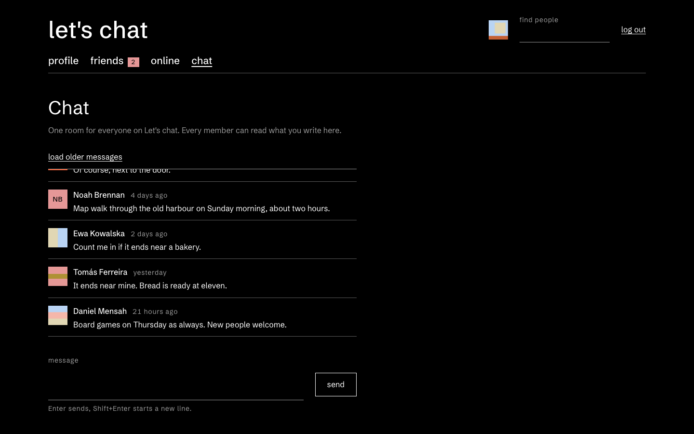
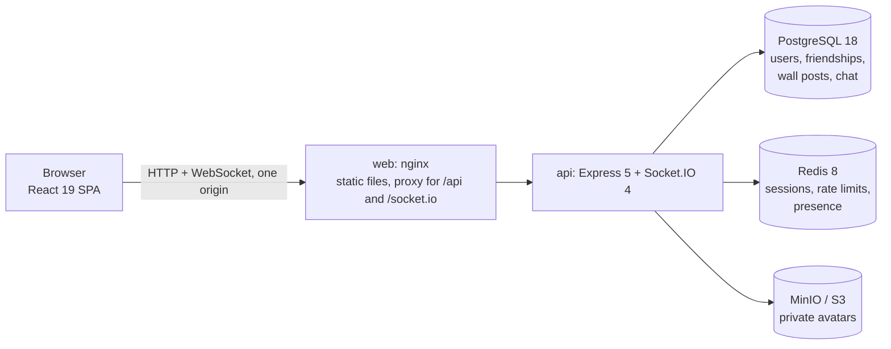

# social-network

A small social network ("Let's chat!") where people keep a profile, make friends, write on each other's walls and
talk in one live chat room. It is my 2018 bootcamp project, rebuilt from scratch with a shared Zod contract between
a React 19 app and an Express 5 + Socket.IO API.

[](https://github.com/Arnoldovna/social-network/actions/workflows/ci.yml)
[](https://github.com/Arnoldovna/social-network/actions/workflows/release.yml)
[](LICENSE)





| Mobile (390 px)                                                                                                                                                    | Dark mode                                                                                                                                                                                                                       |
| ------------------------------------------------------------------------------------------------------------------------------------------------------------------ | ------------------------------------------------------------------------------------------------------------------------------------------------------------------------------------------------------------------------------- |
|  |  |

## Features

- **Accounts**: register, log in, log out. Passwords are hashed with argon2id, the session lives in Redis and gets a
  new id on every login, and login attempts are limited per IP and per account.
- **Profile and avatar**: a bio and a profile picture. The upload is checked by its bytes (`file-type`), not by its
  name or MIME header, re-encoded by sharp to a 512 × 512 WebP without metadata and stored in a private bucket. The
  API serves it, so the bucket never needs to be public.
- **Friends**: send, cancel, accept or decline a request, and unfriend. A unique index on the unordered user pair
  makes a duplicate friendship impossible, even when both people click at the same time. The request badge in the
  navigation updates live.
- **Walls**: friends write on each other's walls, and only friends can read them. Only the author or the wall owner
  can delete a post, and new posts reach exactly the people who have that wall open (one Socket.IO room per wall).
- **Chat**: one room for everyone. History loads over HTTP with keyset pagination; new messages go over the socket,
  are validated against the shared schema, and every send is acknowledged with the stored message or an error code.
- **Who is online**: presence is tracked in Redis as a set of sockets per user with a 5-second grace period, so a page
  reload does not show someone leaving and coming back.
- **Search**: prefix search on first, last or full name. `%` and `_` are matched literally.
- **Responsive and accessible**: the e2e suite runs at 390 px and 1440 px with an axe check (WCAG 2.2 AA) on every
  page state, and the colours follow the system's light or dark setting.

## Tech stack

| Area                       | Choice                                                                                         | Why                                                                                                                                                                                                                                                 |
| -------------------------- | ---------------------------------------------------------------------------------------------- | --------------------------------------------------------------------------------------------------------------------------------------------------------------------------------------------------------------------------------------------------- |
| Frontend                   | React 19, Vite, React Router 8, Redux Toolkit with RTK Query, react-hook-form                  | RTK Query owns the server state, and socket events patch its cache, so a live post and a refetch never disagree ([ADR-0012](docs/architecture/adr/0012-frontend-state-rtk-query.md)).                                                               |
| Contract                   | Zod 4 in `packages/shared`                                                                     | One schema per request, response and socket event. The API validates with it, and the web app takes its types and its test mocks from it.                                                                                                           |
| Backend                    | Express 5, TypeScript, Socket.IO 4                                                             | Express 5 forwards rejected promises to the error handler, which removed the hanging requests of the old version. Mutations go over HTTP; the socket only pushes ([ADR-0008](docs/architecture/adr/0008-realtime-socketio-rooms-and-publisher.md)). |
| Data                       | PostgreSQL 18 with Drizzle ORM and committed SQL migrations                                    | Constraints carry the rules (friendship pair, non-empty posts, lower-case emails), and CI fails when the schema and the migrations drift apart.                                                                                                     |
| Sessions, limits, presence | Redis 8                                                                                        | Sessions, rate limiters and presence survive an API restart and do not assume a single API instance.                                                                                                                                                |
| Files                      | S3 API, MinIO locally                                                                          | Avatars are stored under server-generated keys in a private bucket ([ADR-0010](docs/architecture/adr/0010-avatar-upload-pipeline.md)).                                                                                                              |
| Styling                    | Tailwind CSS 4 inside BEM CSS files, design tokens, no utility classes in markup               | The maw-studio identity with a rose accent; a script and Stylelint enforce the rules ([ADR-0015](docs/architecture/adr/0015-design-identity-and-css.md)).                                                                                           |
| Quality                    | Vitest, Supertest + Testcontainers, Playwright + axe, ESLint with import boundaries            | Integration tests start their own Postgres and Redis, and the e2e suite drives the production images.                                                                                                                                               |
| Delivery                   | Docker (nginx-unprivileged for the web app, distroless Node for the API), GitHub Actions, GHCR | The demo, the e2e suite and production use the same images.                                                                                                                                                                                         |

## Architecture



Both apps are split into feature modules with the same names: `auth`, `users`/`profile`, `avatars`, `friends`,
`wall`, `chat`, `presence` (and `search` in the web app). On the API side each module goes routes → controller →
service → repository and is wired in one composition root (`apps/api/src/container.ts`) with factory functions,
not singletons. Features never import each other: the wall asks a `FriendshipReader` port and publishes through a
`RealtimePublisher` port, and ESLint (`eslint-plugin-boundaries`) rejects an import from one feature into another.
Every HTTP error leaves the API as an RFC 9457 problem document, and socket events answer with an acknowledgement
that carries the same error codes ([ADR-0004](docs/architecture/adr/0004-error-model-problem-json.md)). The full
reasoning is in [`docs/architecture`](docs/architecture/OVERVIEW.md) and the 19 [ADRs](docs/architecture/adr/).

## What changed since the 2018 version

Before the rebuild I reviewed the old code and wrote down every defect I found: 142 entries in
[`docs/BUGS.md`](docs/BUGS.md), each with the file and line it came from. The rebuild closes all of them; a few of
the ones that taught me the most:

| 2018 bootcamp version                                                                                                                                        | 2026 rebuild                                                                                                                                 |
| ------------------------------------------------------------------------------------------------------------------------------------------------------------ | -------------------------------------------------------------------------------------------------------------------------------------------- |
| Database and cloud credentials in a committed `secrets.json`, the session secret in the code (B-01, B-02)                                                    | Every secret comes from a Zod-validated environment; `pnpm dev:setup` generates them locally, and gitleaks runs before each commit and in CI |
| `SELECT *` on users, so profile routes and socket broadcasts sent emails and password hashes to every client (B-19)                                          | Explicit column lists and DTOs per use case (`PublicUser`, `Me`), checked by response schemas in the tests                                   |
| Any socket, even without a login, could delete any wall post (B-21, B-38)                                                                                    | `DELETE /api/posts/:id` only for the author or the wall owner, an authenticated socket handshake, CSRF on every mutation                     |
| Opening a profile broadcast its posts to everyone, so every open wall suddenly showed someone else's posts (B-39)                                            | Posts load over HTTP; live updates go to one room per wall                                                                                   |
| A new post carried the author's user id as its post id, so deleting it removed an unrelated post (B-41)                                                      | One `INSERT … RETURNING` with the author joined, typed by the shared `WallPost` schema                                                       |
| Uploads stored with the client's file name and MIME type in a public bucket, which allowed HTML files on the bucket domain (B-29, B-30)                      | Type detected from the bytes, re-encoded by sharp, server-generated key, private bucket                                                      |
| The chat input only appeared once there was a message, so nobody could send the first one; other people's messages cleared what you were typing (B-84, B-83) | Controlled inputs that clear only after your own message was acknowledged                                                                    |
| A schema script that failed on its second run, presence in a module-level array (B-63, B-44)                                                                 | Drizzle migrations with a drift check in CI, presence in Redis                                                                               |
| `position: absolute` with numbers like `right: 442px`, no focus styles, images without `alt` (B-114, B-106, B-102)                                           | Grid and flex on spacing tokens, visible focus, axe in every e2e test                                                                        |
| `"test": "echo \"Error: no test specified\""` (B-139)                                                                                                        | Unit, integration, e2e and accessibility tests in `pnpm verify` and in CI                                                                    |

What I took from it: in 2018 the app worked in the demo, and most of the bugs were invisible until two people used
it at once. Opening a wall replaced everybody's wall, and one reload reset the chat for all users. So this time the
realtime behaviour is tested with two browser contexts side by side, not only over HTTP. I also learned to put the
rules where they cannot be skipped: a database constraint for the friendship pair, a schema in `packages/shared`
for every payload, an ownership check in the delete query itself. Writing the bug list first was slow, but it gave
the rebuild a clear definition of done: [`TRACEABILITY.md`](docs/architecture/TRACEABILITY.md) maps every entry to
the decision that fixes it. Out of scope on purpose: images on walls, private messages, password reset and account
deletion ([ADR-0011](docs/architecture/adr/0011-scope-wall-visibility-and-v1-exclusions.md)).

## Getting started

Requirements: Node 26 (`.nvmrc`), pnpm 10.34.9 (`corepack enable` picks it up from `packageManager`), Docker with
Compose 2.24.4 or later.

Try it (production images with demo data):

```bash
pnpm install
pnpm demo            # creates .env with generated secrets, starts the stack, prints the URL and the demo login
```

The demo runs on `http://127.0.0.1:8080`. If that port is taken, pick another one, for example
`WEB_PORT=8090 pnpm demo`. `pnpm stack:down` stops the stack and keeps the data.

Develop:

```bash
pnpm install
pnpm dev:setup       # .env with generated secrets (never overwritten), Postgres, Redis and MinIO, migrations, seed
pnpm dev             # web on http://localhost:5173, API on http://localhost:3000
```

## Scripts

| Script                                                  | What it does                                                                                                     |
| ------------------------------------------------------- | ---------------------------------------------------------------------------------------------------------------- |
| `pnpm demo`                                             | production images with demo data, for a quick look                                                               |
| `pnpm dev:setup`                                        | one-time local setup; running it again changes nothing                                                           |
| `pnpm dev`                                              | web and API in watch mode                                                                                        |
| `pnpm build`                                            | builds `packages/shared`, the API and the web app                                                                |
| `pnpm verify`                                           | everything CI runs: format, lint, Stylelint, utility-class check, types, unit, integration, build, e2e, gitleaks |
| `pnpm test` / `pnpm test:integration` / `pnpm test:e2e` | unit / API against real Postgres and Redis / browser tests with axe                                              |
| `pnpm db:generate` / `pnpm db:migrate` / `pnpm db:seed` | new migration from the schema / apply migrations / demo data                                                     |
| `pnpm stack:up` / `pnpm stack:down`                     | the production images on the local compose project                                                               |
| `E2E_BASE_URL=<demo URL> pnpm media:readme`             | regenerates the README screenshots and the flow clip from the running demo                                       |

## Testing

- **Unit** (Vitest): services with in-memory fakes, shared schemas and policies, React components with Testing
  Library and MSW handlers built from the shared schemas.
- **Integration** (Supertest + Testcontainers): the real Express app and a real Socket.IO server against Postgres 18
  and Redis 8 in containers, one cloned database per test file. Every route is tested for the happy path, invalid
  input, 401, someone else's resource and a missing CSRF token; every socket event for valid, invalid,
  unauthenticated, forbidden and rate-limited.
- **End to end** (Playwright): the production images in their own compose project, at 1440 × 900 and 390 × 844. The
  realtime journeys (wall, chat, presence, friend requests) use two browser contexts as two users. Every page state
  runs an axe check against WCAG 2.2 AA, and a CSP violation in the console fails the test.

At the time of writing that is about 1,430 unit tests, 560 integration tests and 300 e2e runs. `pnpm verify` runs
all of them.

## CI/CD

[`ci.yml`](.github/workflows/ci.yml) runs lint (with a schema drift check), types, unit, integration, build, a
`dev:setup` smoke test that runs the setup twice, and gitleaks over the full history on every pull request and on
`main`; the e2e job runs on pull requests only. [`release.yml`](.github/workflows/release.yml) builds the web and API
images from commits that passed CI on `main` and pushes them to GHCR, but only while the repository is public. The
deploy job is prepared under the same condition and stays off until the `DEPLOY_ENABLED` variable is set
([ADR-0018](docs/architecture/adr/0018-ci-cost-rule.md)). A weekly `pnpm audit` and Dependabot keep the dependencies
current.

## Credits

- Typeface: [Schibsted Grotesk](https://github.com/schibsted/schibsted-grotesk) by the Schibsted Grotesk Project
  Authors, SIL Open Font License 1.1 (see [`LICENSES/OFL-SchibstedGrotesk.txt`](LICENSES/OFL-SchibstedGrotesk.txt)).
  Self-hosted via @fontsource.
- Photos and images: none from third parties. The demo avatars are generated by the seed from flat colour fields
  ([`apps/api/src/db/seed/avatars.ts`](apps/api/src/db/seed/avatars.ts)), and the demo people are fictional with
  `example.com` addresses.

## License

MIT, see [LICENSE](LICENSE).
