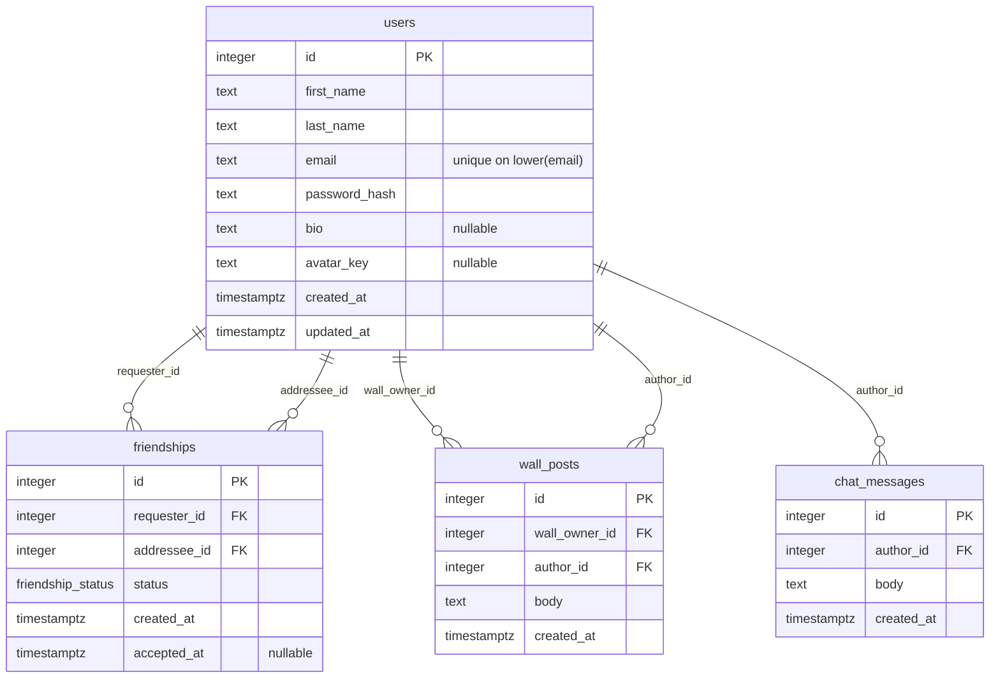

# Data model

Postgres 18 via Drizzle ORM 0.45. TypeScript keys are camelCase and every column names its SQL name explicitly
(`text('first_name')`); `casing` is **not** set (see [Migrations](#migrations)). Sessions, rate-limit counters
and presence live in Redis 8, not in Postgres (see [Redis keys](#redis-keys)). Avatars live in S3-compatible
object storage (MinIO locally); Postgres stores only the object **key**.

Decisions behind this model: [ADR-0007](adr/0007-data-model-conventions.md) (ids, email uniqueness, constraints,
keys instead of URLs), [ADR-0011](adr/0011-scope-wall-visibility-and-v1-exclusions.md) (no wall images, no private
messages), [ADR-0014](adr/0014-cursor-pagination.md) (keyset indexes).



## Conventions

| Topic        | Rule                                                                                                                                                                                                                                                                     |
| ------------ | ------------------------------------------------------------------------------------------------------------------------------------------------------------------------------------------------------------------------------------------------------------------------ |
| Primary keys | `integer GENERATED ALWAYS AS IDENTITY`. 2^31 rows per table is far beyond the scope of this app; JS numbers stay exact; `req.session.userId: number`.                                                                                                                    |
| Timestamps   | `timestamptz(3) NOT NULL DEFAULT now()` (millisecond precision, the same as a JS `Date`, so a keyset cursor round-trips exactly, ADR-0014); stored in UTC, formatted in the client with `Intl` (F-108, B-69).                                                            |
| Text         | `text` + `CHECK (char_length(...) BETWEEN x AND y)` with the same limits as the Zod schemas in `packages/shared` (B-65). Values are trimmed by Zod and the DB rejects untrimmed values, so the invariant holds even for code paths that skip Zod (seed, future scripts). |
| Foreign keys | Explicit `ON DELETE CASCADE` for everything owned by a user (B-67). No account deletion in v1, but the schema is ready for it.                                                                                                                                           |
| Indexes      | One composite index per keyset ordering, one index per FK that is filtered on, expression indexes for case-insensitive lookups (B-68).                                                                                                                                   |
| Names        | `users`, `friendships`, `wall_posts`, `chat_messages`; columns describe their content (B-64).                                                                                                                                                                            |
| Row types    | `typeof table.$inferSelect` stays inside repositories; HTTP and socket layers only see DTOs from `packages/shared` (B-19).                                                                                                                                               |

## Schema (`apps/api/src/db/schema/*.ts`)

All four files plus `index.ts` are written in the **scaffold phase** (see BUILD-ORDER.md) so the single initial
migration exists before feature modules are built in parallel.

### `users.ts`

```ts
import { sql } from 'drizzle-orm';
import { check, index, integer, pgTable, text, timestamp, uniqueIndex } from 'drizzle-orm/pg-core';

export const users = pgTable(
  'users',
  {
    id: integer('id').primaryKey().generatedAlwaysAsIdentity(),
    firstName: text('first_name').notNull(),
    lastName: text('last_name').notNull(),
    email: text('email').notNull(),
    passwordHash: text('password_hash').notNull(),
    bio: text('bio'),
    avatarKey: text('avatar_key'),
    createdAt: timestamp('created_at', { withTimezone: true, precision: 3 }).notNull().defaultNow(),
    updatedAt: timestamp('updated_at', { withTimezone: true, precision: 3 })
      .notNull()
      .defaultNow()
      .$onUpdate(() => new Date()),
  },
  (t) => [
    // Case-insensitive uniqueness without the citext extension (ADR-0007). Emails are stored lower-cased anyway.
    uniqueIndex('users_email_lower_idx').on(sql`lower(${t.email})`),
    check('users_email_lowercase_chk', sql`${t.email} = lower(${t.email})`),
    check('users_email_len_chk', sql`char_length(${t.email}) between 3 and 254`),
    check(
      'users_first_name_chk',
      sql`char_length(${t.firstName}) between 1 and 100 and ${t.firstName} = btrim(${t.firstName})`,
    ),
    check(
      'users_last_name_chk',
      sql`char_length(${t.lastName}) between 1 and 100 and ${t.lastName} = btrim(${t.lastName})`,
    ),
    // NULL means "no bio". An empty string is never stored (Zod maps '' to null).
    check('users_bio_chk', sql`${t.bio} is null or (char_length(${t.bio}) between 1 and 1000)`),
    // Only server-generated keys of this very row can ever be stored (B-30): exactly the shape `newAvatarKey(id)`
    // builds (no leading zero, a lowercase UUID) and the row's own id as the key's user, so `createAvatarUrl` can never
    // meet a stored key it refuses (a key of another user would make every list that includes this user a 500).
    check(
      'users_avatar_key_chk',
      sql`${t.avatarKey} is null or (${t.avatarKey} ~ '^avatars/[1-9][0-9]*/[0-9a-f]{8}-[0-9a-f]{4}-[0-9a-f]{4}-[0-9a-f]{4}-[0-9a-f]{12}\\.webp$' and split_part(${t.avatarKey}, '/', 2) = ${t.id}::text)`,
    ),
    // Prefix search (F-60): LIKE 'abc%' on lower(...) can use a text_pattern_ops btree index.
    index('users_first_name_prefix_idx').using('btree', sql`lower(${t.firstName}) text_pattern_ops`),
    index('users_last_name_prefix_idx').using('btree', sql`lower(${t.lastName}) text_pattern_ops`),
    index('users_full_name_prefix_idx').using(
      'btree',
      sql`(lower(${t.firstName} || ' ' || ${t.lastName})) text_pattern_ops`,
    ),
  ],
);
```

### `friendships.ts`

```ts
import { sql } from 'drizzle-orm';
import { check, index, integer, pgEnum, pgTable, timestamp, uniqueIndex } from 'drizzle-orm/pg-core';

import { users } from './users.js';

export const friendshipStatus = pgEnum('friendship_status', ['pending', 'accepted']);

export const friendships = pgTable(
  'friendships',
  {
    id: integer('id').primaryKey().generatedAlwaysAsIdentity(),
    requesterId: integer('requester_id')
      .notNull()
      .references(() => users.id, { onDelete: 'cascade' }),
    addresseeId: integer('addressee_id')
      .notNull()
      .references(() => users.id, { onDelete: 'cascade' }),
    status: friendshipStatus('status').notNull().default('pending'),
    createdAt: timestamp('created_at', { withTimezone: true, precision: 3 }).notNull().defaultNow(),
    acceptedAt: timestamp('accepted_at', { withTimezone: true, precision: 3 }),
  },
  (t) => [
    check('friendships_not_self_chk', sql`${t.requesterId} <> ${t.addresseeId}`), // B-24
    check('friendships_accepted_at_chk', sql`(${t.status} = 'accepted') = (${t.acceptedAt} is not null)`),
    // One row per unordered pair, whichever side asked first (F-51, B-25).
    uniqueIndex('friendships_pair_idx').on(
      sql`least(${t.requesterId}, ${t.addresseeId})`,
      sql`greatest(${t.requesterId}, ${t.addresseeId})`,
    ),
    index('friendships_requester_status_idx').on(t.requesterId, t.status),
    index('friendships_addressee_status_idx').on(t.addresseeId, t.status),
  ],
);
```

State derivation (repository → service, never stored as text, B-53):

| Row between me and them        | `FriendshipState` (from my point of view) |
| ------------------------------ | ----------------------------------------- |
| none                           | `none`                                    |
| `pending`, `requester_id = me` | `pending_outgoing`                        |
| `pending`, `addressee_id = me` | `pending_incoming`                        |
| `accepted`                     | `friends`                                 |

### `wall-posts.ts`

```ts
import { sql } from 'drizzle-orm';
import { check, index, integer, pgTable, text, timestamp } from 'drizzle-orm/pg-core';

import { users } from './users.js';

export const wallPosts = pgTable(
  'wall_posts',
  {
    id: integer('id').primaryKey().generatedAlwaysAsIdentity(),
    wallOwnerId: integer('wall_owner_id')
      .notNull()
      .references(() => users.id, { onDelete: 'cascade' }),
    authorId: integer('author_id')
      .notNull()
      .references(() => users.id, { onDelete: 'cascade' }),
    body: text('body').notNull(),
    // precision 3 = JS Date precision; the keyset cursor compares against this exact value (ADR-0014).
    createdAt: timestamp('created_at', { withTimezone: true, precision: 3 }).notNull().defaultNow(),
  },
  (t) => [
    check('wall_posts_body_chk', sql`char_length(${t.body}) between 1 and 2000 and ${t.body} = btrim(${t.body})`),
    index('wall_posts_wall_created_idx').on(t.wallOwnerId, t.createdAt.desc().nullsFirst(), t.id.desc().nullsFirst()),
    index('wall_posts_author_idx').on(t.authorId),
  ],
);
```

No `image_key` column: wall image posts (F-68) are out of scope for v1
([ADR-0011](adr/0011-scope-wall-visibility-and-v1-exclusions.md), B-71).

### `chat-messages.ts`

```ts
import { sql } from 'drizzle-orm';
import { check, index, integer, pgTable, text, timestamp } from 'drizzle-orm/pg-core';

import { users } from './users.js';

export const chatMessages = pgTable(
  'chat_messages',
  {
    id: integer('id').primaryKey().generatedAlwaysAsIdentity(),
    authorId: integer('author_id')
      .notNull()
      .references(() => users.id, { onDelete: 'cascade' }),
    body: text('body').notNull(),
    // precision 3 = JS Date precision; the keyset cursor compares against this exact value (ADR-0014).
    createdAt: timestamp('created_at', { withTimezone: true, precision: 3 }).notNull().defaultNow(),
  },
  (t) => [
    check('chat_messages_body_chk', sql`char_length(${t.body}) between 1 and 1000 and ${t.body} = btrim(${t.body})`),
    index('chat_messages_created_idx').on(t.createdAt.desc().nullsFirst(), t.id.desc().nullsFirst()),
    index('chat_messages_author_idx').on(t.authorId),
  ],
);
```

### `index.ts`

```ts
export * from './users.js';
export * from './friendships.js';
export * from './wall-posts.js';
export * from './chat-messages.js';
```

## Expected SQL (review checklist for `drizzle/0000_*.sql`)

drizzle-kit output must be reviewed before it is committed. It must contain, among the plain table DDL:

```sql
CREATE TYPE "public"."friendship_status" AS ENUM('pending', 'accepted');
-- in each CREATE TABLE: "created_at" timestamp (3) with time zone DEFAULT now() NOT NULL
CREATE UNIQUE INDEX "users_email_lower_idx" ON "users" USING btree (lower("email"));
CREATE INDEX "users_full_name_prefix_idx" ON "users" USING btree ((lower("first_name" || ' ' || "last_name")) text_pattern_ops);
CREATE UNIQUE INDEX "friendships_pair_idx" ON "friendships" USING btree (least("requester_id", "addressee_id"), greatest("requester_id", "addressee_id"));
CREATE INDEX "wall_posts_wall_created_idx" ON "wall_posts" USING btree ("wall_owner_id","created_at" DESC NULLS FIRST,"id" DESC NULLS FIRST);
CREATE INDEX "chat_messages_created_idx" ON "chat_messages" USING btree ("created_at" DESC NULLS FIRST,"id" DESC NULLS FIRST);
ALTER TABLE "friendships" ADD CONSTRAINT "friendships_requester_id_users_id_fk" FOREIGN KEY ("requester_id") REFERENCES "public"."users"("id") ON DELETE cascade ON UPDATE no action;
```

The two keyset indexes say `.desc().nullsFirst()`: drizzle renders a bare `.desc()` as `DESC NULLS LAST`, which
the planner cannot use for `ORDER BY created_at DESC, id DESC` (that order means `NULLS FIRST`; EXPLAIN showed a
full sort instead of `Index Only Scan`). The columns are `NOT NULL`, so the index content is the same (ADR-0014).

Columns are named explicitly and `casing` is not configured, which removes the known drizzle-kit risk of
rendering camelCase names inside `sql` templates of checks and expression indexes when `casing: 'snake_case'` is
set. If the generated SQL still deviates from the checklist, fix the schema rather than hand-editing the migration.
The integration test suite applies the migrations to a fresh Postgres 18 container (template database) on every
run, so a broken migration fails CI. Until 1b generates `0000_init.sql`, the schema index is `export {};` and the
journal has no entries (Phase 1a skeleton, conventions §3).

## Key queries (repository level)

| Use                         | Query shape                                                                                                                                                                                                                                                                                                                                                                                        | Index used                         |
| --------------------------- | -------------------------------------------------------------------------------------------------------------------------------------------------------------------------------------------------------------------------------------------------------------------------------------------------------------------------------------------------------------------------------------------------- | ---------------------------------- |
| Login                       | `select id, password_hash … where lower(email) = $1` (one query, B-14)                                                                                                                                                                                                                                                                                                                             | `users_email_lower_idx`            |
| Public user                 | `select id, first_name, last_name, bio, avatar_key … where id = $1` (explicit columns, B-19)                                                                                                                                                                                                                                                                                                       | PK                                 |
| Search (F-60, F-61)         | `where id <> $me and (lower(first_name) like lower($p) escape '\' or lower(last_name) like lower($p) escape '\' or lower(first_name \|\| ' ' \|\| last_name) like lower($p) escape '\') order by lower(first_name), lower(last_name), id limit $n`; `$p` = escaped trimmed query + `%` (B-74), folded by the same Postgres `lower()` as the column (JavaScript lower-casing differs outside ASCII) | the three prefix indexes           |
| Friendship between a and b  | `where least(requester_id, addressee_id) = least($a,$b) and greatest(...) = greatest($a,$b)`                                                                                                                                                                                                                                                                                                       | `friendships_pair_idx`             |
| Send request                | `insert … on conflict do nothing returning id`; no row → 409 (B-25)                                                                                                                                                                                                                                                                                                                                | pair index                         |
| Accept                      | `update … set status='accepted', accepted_at=now() where requester_id=$them and addressee_id=$me and status='pending' returning id`; no row → 404 (B-26)                                                                                                                                                                                                                                           | `friendships_requester_status_idx` |
| Cancel / decline / unfriend | `delete … where <pair = (me, them)> returning status, requester_id`; no row → 404                                                                                                                                                                                                                                                                                                                  | pair index                         |
| Friends page                | three selects joined to `users` (accepted either direction, pending incoming, pending outgoing), ordered by name                                                                                                                                                                                                                                                                                   | requester/addressee status indexes |
| Wall page (F-70)            | `select p.id, p.wall_owner_id, p.body, p.created_at, a.<public cols> from wall_posts p join users a on a.id = p.author_id where p.wall_owner_id = $owner and (p.created_at, p.id) < ($t, $id) order by p.created_at desc, p.id desc limit $n + 1`; `$t` is the cursor's millisecond timestamp, exact because the column is `timestamptz(3)`                                                        | `wall_posts_wall_created_idx`      |
| Set avatar (F-37, F-39)     | `UPDATE users SET avatar_key = $new WHERE id = $me RETURNING OLD.avatar_key AS old_key, NEW.id, NEW.first_name, NEW.last_name, NEW.bio, NEW.avatar_key` (Postgres 18 `OLD`/`NEW` in `RETURNING`, through `sql`); atomic, so concurrent uploads each get the key they replaced                                                                                                                      | PK                                 |
| Avatar route                | `select avatar_key from users where id = $1` per image request                                                                                                                                                                                                                                                                                                                                     | PK                                 |
| Create post (B-41, B-75)    | one CTE: `with ins as (insert … returning *) select ins.*, a.<public cols> from ins join users a on a.id = ins.author_id`                                                                                                                                                                                                                                                                          | –                                  |
| Delete post (B-21)          | `delete from wall_posts where id = $id and (author_id = $me or wall_owner_id = $me) returning id, wall_owner_id`; on no row, a second `select` decides 404 vs 403                                                                                                                                                                                                                                  | PK                                 |
| Chat page (F-82)            | like the wall page on `chat_messages`                                                                                                                                                                                                                                                                                                                                                              | `chat_messages_created_idx`        |
| Create chat message (B-47)  | CTE `insert … returning` + join author                                                                                                                                                                                                                                                                                                                                                             | –                                  |
| Presence list               | `select <public cols> from users where id = any($ids)` (one query per `GET /api/presence`)                                                                                                                                                                                                                                                                                                         | PK                                 |

## Migrations

- `pnpm db:generate` (drizzle-kit 0.31.11) writes `apps/api/drizzle/NNNN_<name>.sql` + `meta/`. Review, commit with
  the code, never edit an applied migration (B-63).
- Schema drift is caught in CI: the `lint` job runs `drizzle-kit generate` and fails if `apps/api/drizzle` then
  differs from the commit (`git diff --exit-code` + no untracked files), so a schema edit without its migration
  cannot merge.
- v1 ships exactly one migration, `0000_init`, generated in the scaffold phase from the complete schema above.
  Feature phases must not change the schema; if a builder needs a change, it is a new migration added after the
  phase by one agent only (migrations are sequential and cannot be generated in parallel).
- Local: `pnpm db:migrate` (tsx, `.env`). Docker / CI e2e: the one-shot `migrate` compose service runs
  `node dist/db/migrate.js` before `api` starts. Integration tests: `test/global-setup.ts` runs the migrations
  against the template database `social_network_template` in the Testcontainers Postgres, and every test file gets
  its own clone (conventions §7).
- The app process never migrates on boot.

## Seed plan (`apps/api/src/db/seed/`)

Purpose: realistic data for local development, README screenshots and read-only E2E journeys (F-115). Mutation
E2E tests create their own users through the API (see ADR-0016), so they never depend on seed state.

### Rules

- Idempotent and insert-only: if the demo user already exists the seed logs "already seeded" and exits 0. All rows
  are written in **one transaction**; avatar objects are put before the commit, so a failed run leaves no demo user
  and the next run starts over (objects of a failed run stay unreferenced under `avatars/` and are never served).
- **No reset command** (ADR-0019 §7): the first draft's `--reset` was guarded by `NODE_ENV`, which conventions §8
  forbids. Resetting local data is `docker compose --profile app down -v` (drops the Postgres and MinIO volumes),
  then `pnpm dev:setup`. Integration tests never truncate either; every test file, `seed.int.test.ts` included, runs
  against its own database cloned from the migrated template (ADR-0016, conventions §7).
- Entry point `src/db/seed/cli.ts` (the `db:seed` script runs it with `tsx --conditions=development
--env-file-if-exists=../../.env`; the compose `seed` service runs `dist/db/seed/cli.js`; the template's
  `src/db/seed.ts` is not used). The logic lives in `src/db/seed/index.ts` (`assertSeedAllowed(env)`,
  `runSeed({ db, storage, password, logger, now })`) without side effects at import, so `seed.int.test.ts` runs it
  in-process against its own database and the fake storage.
- Runs only with an explicit `SEED_ALLOW=true` (set per invocation by the `db:seed` script and the compose `seed`
  service; never an `.env` key; the guard never relies on `NODE_ENV`, conventions §8). The compose `seed` service
  runs the production API image with `NODE_ENV=production` and `SEED_ALLOW: 'true'`, so the demo and e2e stacks are
  seeded too.
- Password for every seeded account comes from `SEED_DEMO_PASSWORD` (min. 12 characters). No password literal in the
  repo. `pnpm setup:env` generates it and prints the demo login; compose refuses to start without it
  (`${SEED_DEMO_PASSWORD:?…}`) and passes it to the `seed` service only. E2E specs never log in as a seeded account. Nothing is copied from the legacy database or legacy code.
- Deterministic: a seeded PRNG (`mulberry32(20261115)`) picks avatar compositions and timestamps, so screenshots are
  reproducible. Timestamps are relative to "now" (spread over the last 42 days), so the app never looks stale.
  Rows are inserted in chronological order, so identity ids and `created_at` agree.
- Emails use the reserved `example.com` domain.

### Files

| File              | Content                                                                                                                                                                           |
| ----------------- | --------------------------------------------------------------------------------------------------------------------------------------------------------------------------------- |
| `seed/cli.ts`     | entry point: reads `process.env`, `assertSeedAllowed`, validates its keys with Zod (key names only on failure), opens the pool and S3 storage, calls `runSeed`, closes, exit code |
| `seed/index.ts`   | `assertSeedAllowed(env)`, `runSeed(deps)`: "already seeded" check, one transaction, orchestration of the files below                                                              |
| `seed/people.ts`  | the 14 people below (names, bios, which ones get an avatar)                                                                                                                       |
| `seed/content.ts` | wall post and chat message texts, friendship graph                                                                                                                                |
| `seed/avatars.ts` | generated abstract avatar: SVG string → `sharp` → 512×512 WebP → `storage.put('avatars/<id>/<uuid>.webp')`                                                                        |

### People (fictional; no real persons)

| #   | Name                        | Email                         | Bio (excerpt)                                                                              | Avatar          |
| --- | --------------------------- | ----------------------------- | ------------------------------------------------------------------------------------------ | --------------- |
| 1   | **Mira Novak** (demo login) | `mira.novak@example.com`      | "Front-end developer in Leipzig. Collects risograph prints and opinions about bike lanes." | generated       |
| 2   | Tomás Ferreira              | `tomas.ferreira@example.com`  | "Sound engineer by day, bread baker by night. Sourdough starter is called Gil."            | generated       |
| 3   | Aiko Tanaka                 | `aiko.tanaka@example.com`     | "Type designer. Currently drawing a grotesque with too many ampersands."                   | generated       |
| 4   | Noah Brennan                | `noah.brennan@example.com`    | "Climbing, maps, and the occasional pub quiz win."                                         | none (initials) |
| 5   | Priya Raman                 | `priya.raman@example.com`     | "Data journalist. Ask me about public transport delays, I have charts."                    | generated       |
| 6   | Jonas Weber                 | `jonas.weber@example.com`     | "Carpenter learning TypeScript. Both involve measuring twice."                             | generated       |
| 7   | Amara Okafor                | `amara.okafor@example.com`    | "Architect, plant hoarder, Sunday market regular."                                         | generated       |
| 8   | Mateo Rossi                 | `mateo.rossi@example.com`     | – (no bio, shows the empty state)                                                          | none            |
| 9   | Sofia Lindqvist             | `sofia.lindqvist@example.com` | "Illustrator. Draws the neighbourhood one staircase at a time."                            | generated       |
| 10  | Yusuf Demir                 | `yusuf.demir@example.com`     | "Backend developer and amateur beekeeper. 40,000 colleagues."                              | generated       |
| 11  | Clara Moreau                | `clara.moreau@example.com`    | "Translator (FR/DE/EN). Reading three books at once, finishing none."                      | none            |
| 12  | Ewa Kowalska                | `ewa.kowalska@example.com`    | "Ceramicist. Mostly glaze tests and slightly wonky cups."                                  | generated       |
| 13  | Daniel Mensah               | `daniel.mensah@example.com`   | "Teaches maths, plays bass, runs the Thursday board game night."                           | generated       |
| 14  | Hannah Schulz               | `hannah.schulz@example.com`   | –                                                                                          | none            |

### Friendship graph (from Mira's point of view, to show every state)

- friends: Tomás, Aiko, Priya, Jonas, Amara
- incoming requests (pending, addressee = Mira): Sofia, Yusuf → nav badge shows 2
- outgoing request (pending, requester = Mira): Clara
- no relation: Noah, Mateo, Ewa, Daniel, Hannah (search and "add friend" demo)
- among others: a small mesh (Tomás–Aiko, Priya–Jonas, Amara–Ewa, Daniel–Noah, Sofia–Ewa accepted) so other
  walls are readable when logging in as them.

### Content

- Walls: 3–9 posts on each of Mira's friends' walls and 14 on Mira's own wall (more than one page of 20 is
  reached only on the shared chat, see below), authored by the owner or a friend. Examples:
  - "Finished the risograph run for the zine. 120 copies, two colours, one paper jam."
  - "Anyone up for the Saturday ride along the Elster? Leaving 10:00 from the Konnewitz bridge."
  - "Gil survived the heatwave. Bread on Friday for whoever brings jam."
  - "Lecture notes from yesterday's type talk are on my profile. The ampersand section is long."
  - "Thanks for the plant cutting. It has already outgrown the pot."
- Chat: 46 messages over 6 weeks (so "load older messages" is demonstrable with a page size of 20), e.g.
  "Board games on Thursday, who is in?", "Bringing Carcassonne and the bad expansion.", "Is the Karl-Heine
  bakery open on Sundays?", "Only until noon.", "Reminder: the library swaps books on the first of the month."
- No lorem ipsum, no "Jane Doe", no emoji (maw anti-AI checklist).

### Avatar images

Generated, not downloaded: each avatar is an SVG of 2–3 flat colour fields from the maw accent palette (rose, sky,
sand, olive, apricot, blush, rust, vermilion) in one of six compositions (vertical split, horizontal split, corner
square, centred bar, stacked thirds, offset square), rendered to WebP by `sharp` with the same pipeline as user
uploads. No faces, no stock photos, no third-party images, so no attribution is needed; the README credits note
"seed avatars are generated abstract compositions". Four people have no avatar to show the initials fallback.

## Redis keys

Prefix `social-network:` (= `APP_SLUG`) on everything. The prefix is a dependency (`keyPrefix`) of the session
store, limiter stores, socket limiters and the presence store, never a literal: integration tests pass
`test-<uuid>`, so `presence.onBoot()` (SCAN + DEL of `<prefix>:presence:*`) only clears its own namespace.

Compose runs Redis without persistence and with `--maxmemory 128mb --maxmemory-policy volatile-ttl`: sessions and
counters carry TTLs and are evicted first; presence keys (no TTL, small) are never evicted. Anonymous sessions
created by `GET /api/csrf-token` live 2 h, not 7 days.

| Key                                        | Type                             | TTL                                                        | Owner                                                                                             |
| ------------------------------------------ | -------------------------------- | ---------------------------------------------------------- | ------------------------------------------------------------------------------------------------- |
| `social-network:sess:<sid>`                | string (JSON)                    | rolling, `SESSION_TTL_DAYS` (7); anonymous (CSRF only) 2 h | express-session / connect-redis                                                                   |
| `social-network:rl:<limiter>:<key>`        | counters                         | window                                                     | rate-limit-redis (`global`, `auth`, `login-email-ip`, `login-email`, `upload`, `search`, `write`) |
| `social-network:rl:<name>:<userId>`        | counter                          | window                                                     | socket event limiter (`chat-send`, `wall-join`; `shared/realtime/event-limiter.ts`)               |
| `social-network:rl:ws-handshake:<ip>`      | counter                          | 1 min                                                      | socket handshake limiter                                                                          |
| `social-network:presence:sockets:<userId>` | set of `<instanceId>:<socketId>` | none (cleaned on disconnect and on boot)                   | presence                                                                                          |
| `social-network:presence:online`           | set of userIds                   | none                                                       | presence                                                                                          |

Login limiter keys use `sha256(lower(email))` (`login-email`) and `sha256(lower(email)) + ':' + ip`
(`login-email-ip`), never the plain address (F-113).
