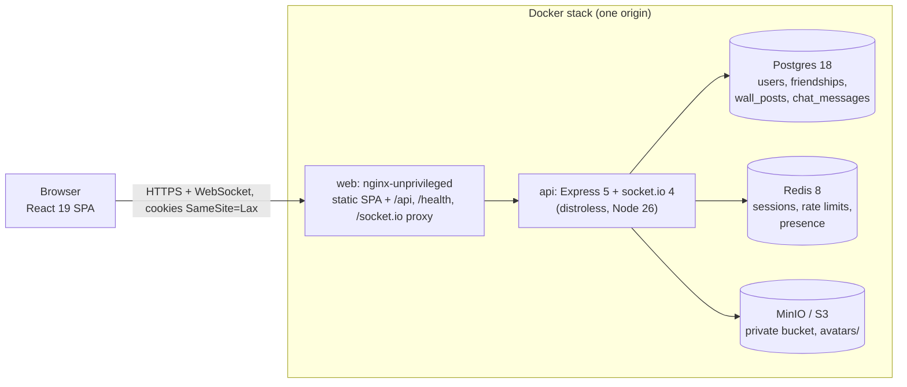
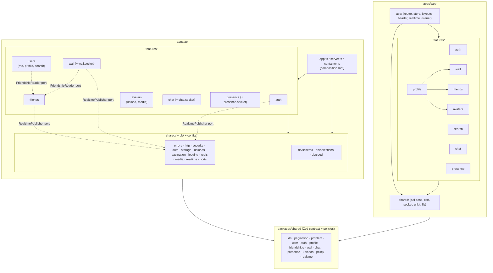
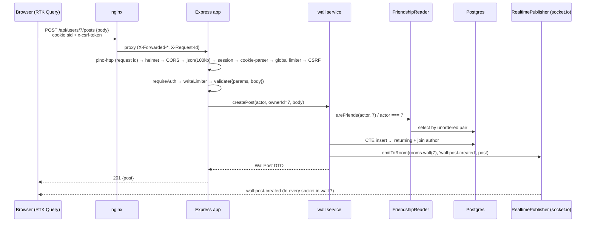
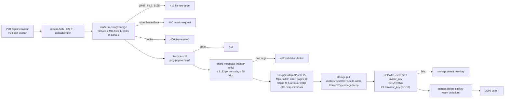

# Architecture overview: social-network ("Let's chat!")

Status: proposed, revised after the architecture critique and re-reviewed after the cross-project consistency pass
([ADR-0018](adr/0018-ci-cost-rule.md), [ADR-0019](adr/0019-consistency-pass-alignment.md)). Binding inputs:
`~/PLAN.md`, `project-scaffold/references/conventions.md`,
`docs/FEATURES.md` (F-01 – F-115), `docs/BUGS.md` (B-01 – B-142), the house skills `project-scaffold`,
`express-feature-module`, `maw-design-system`, `modular-css-tailwind4`.

Companion documents: [DATA-MODEL.md](DATA-MODEL.md) · [API.md](API.md) · [BUILD-ORDER.md](BUILD-ORDER.md) ·
[TRACEABILITY.md](TRACEABILITY.md) (every BUGS id → design decision) · [ADRs](adr/).

## 1. Context

A small social network rebuilt from a 2018 bootcamp project: people register, write a bio, upload a profile picture,
send friend requests, write on friends' walls, talk in one global chat room and see who is online. The rebuild keeps
the feature set, fixes every defect in `BUGS.md` (secrets in git, password hashes leaked over sockets, anyone could
delete any post, no tests, ...) and presents it as a portfolio piece in the maw-studio identity with the rose accent
`#E59797`.



Out of scope for v1 ([ADR-0011](adr/0011-scope-wall-visibility-and-v1-exclusions.md)): wall image posts (F-68),
private 1:1 messages, password reset, email verification, account deletion, editing name/email, horizontal
scaling of the API (designed for, not deployed).

## 2. Module map

Backend feature modules (`apps/api/src/features/*`) and frontend feature modules (`apps/web/src/features/*`) carry
the same names wherever they map to the same capability. FEATURES.md module names map as: `auth` → auth,
`profile` → users (API) / profile (web), `upload` → avatars, `friends` → friends (+ search in web), `wall` → wall,
`chat` → chat, `presence` → presence.



Dashed arrows are runtime wiring through interfaces in `shared/ports` and `shared/realtime`; there are no
import-time dependencies between backend features (the composition root passes `friends.reader` into `users`
and `wall`).

## 3. Request flows

### HTTP mutation (example: create a wall post)



Middleware order is the one from `express-feature-module` (§ "Middleware order"), unchanged. The global limiter
keys by `u:<userId>` when the session has one (IP otherwise) and skips the avatar image route.

### Socket event (chat)

`chat:send {body}` → session-alive guard → Zod parse → per-user Redis limiter → `chat.service.send` (insert
returning + author join) → `io.to(rooms.chat).emit('chat:message', msg)` → ack `{ ok: true, message }`. Every
failure is an ack with a code, never a thrown error (F-112).

### Page load

`main.tsx` starts the session listener with the router's `navigate` injected (`startSessionListener(store,
router.navigate)`) and renders `RouterProvider`. The root loader of the app area dispatches
`meApi.endpoints.getMe.initiate()`; a 401 from `/api/me` means "visitor" and redirects silently to `/welcome`
(F-01). The welcome loader does the inverse (F-02) and treats a 401 the same way, so visitors stay on `/welcome`.
Neither loader ever dispatches `sessionExpired`. Once `getMe` succeeds, the realtime listener connects the single
socket; navigation never reconnects it (F-03).

## 4. Folder tree (file level)

Generated files (`dist/`, `drizzle/meta/`, `playwright-report/`) and the template-provided tooling configs listed
in `project-scaffold` are included where they matter.

```
social-network/
├── .github/
│   ├── actions/setup/action.yml
│   ├── workflows/ci.yml                     lint (+ schema drift) · typecheck · unit · integration · build · e2e (PR only) · dev-setup-smoke · gitleaks
│   ├── workflows/audit.yml                  pnpm audit: weekly, on lockfile change on main, manual; not a PR check
│   ├── workflows/release.yml                workflow_run after green CI on main: GHCR images (api, web) only if the repo is public; deploy also gated by vars.DEPLOY_ENABLED (ADR-0018)
│   ├── dependabot.yml                       npm, github-actions, docker, docker-compose
│   └── pull_request_template.md
├── apps/
│   ├── api/
│   │   ├── Dockerfile                       multi-stage, pnpm deploy --prod (package.json#files = dist, + drizzle/), distroless nonroot; build fails if src/ or test/ would ship
│   │   ├── drizzle.config.ts
│   │   ├── drizzle/0000_init.sql (+ meta/)
│   │   ├── package.json  tsconfig.json  tsconfig.build.json  vitest.config.ts  vitest.integration.config.ts
│   │   ├── src/
│   │   │   ├── server.ts                    loadEnv → logger → container → createApp → http server → io.attach → onBoot → listen → sweep; shutdown
│   │   │   ├── container.ts                 pg pool, redis, S3, session, limiter stores, realtime server, readiness
│   │   │   ├── app.ts                       createApp(deps) → { app, onBoot }; registers the socket handlers on deps.io itself
│   │   │   ├── config/env.ts                Zod env (section 13)
│   │   │   ├── config/app.ts                APP_SLUG = 'social-network'
│   │   │   ├── config/limits.ts             DEFAULT_LIMITS, resolveLimits(env) (section 10)
│   │   │   ├── db/client.ts  db/migrate.ts
│   │   │   ├── db/schema/{index,users,friendships,wall-posts,chat-messages}.ts
│   │   │   ├── db/selections.ts             userSummaryColumns, publicUserColumns, toUserSummary(row, avatarUrl), toPublicUser
│   │   │   ├── db/seed/{cli,index,people,content,avatars}.ts   cli = entry point (SEED_ALLOW guard); index = runSeed(deps), no side effects
│   │   │   ├── shared/
│   │   │   │   ├── errors/{app-error,db-errors}.ts
│   │   │   │   ├── http/{problem,validate,health}.ts
│   │   │   │   ├── auth/{guards,password}.ts
│   │   │   │   ├── security/{session,csrf,security,login-limiters}.ts
│   │   │   │   ├── storage/object-storage.ts
│   │   │   │   ├── uploads/{upload,process-image}.ts
│   │   │   │   ├── media/media-url.ts       createAvatarUrl(): (userId, key) → '/api/users/<id>/avatar?v=<uuid>' or null; newAvatarKey, parseAvatarKey
│   │   │   │   ├── pagination/cursor.ts
│   │   │   │   ├── logging/logger.ts
│   │   │   │   ├── redis/redis.ts
│   │   │   │   ├── ports/friendship-reader.ts
│   │   │   │   └── realtime/{socket-server,socket-auth,rooms,publisher,ack,event-limiter,session-guard,types}.ts
│   │   │   └── features/
│   │   │       ├── auth/{auth.schema,auth.repository,auth.service,auth.controller,auth.routes,index}.ts
│   │   │       │   └── __tests__/{auth.service.test,auth.routes.int.test,auth-limits.int.test,fakes}.ts
│   │   │       ├── users/{users.schema,users.repository,users.service,users.controller,users.routes,search-pattern,index}.ts
│   │   │       │   └── __tests__/{users.service.test,search-pattern.test,users.routes.int.test,fakes}.ts
│   │   │       ├── avatars/{avatars.repository,avatars.service,avatars.controller,avatars.routes,index}.ts
│   │   │       │   └── __tests__/{avatars.service.test,avatars.routes.int.test,fakes,fixtures}.ts
│   │   │       ├── friends/{friends.schema,friends.repository,friends.service,friends.controller,friends.routes,index}.ts
│   │   │       │   ├── {friendship-state,friendship-reader}.ts   Phase 1b, frozen: FriendshipReader used by users and wall
│   │   │       │   └── __tests__/{friendship-state.test,friendship-reader.int.test,friends.service.test,friends.routes.int.test,fakes}.ts
│   │   │       ├── wall/{wall.schema,wall.repository,wall.service,wall.controller,wall.routes,wall.socket,index}.ts
│   │   │       │   └── __tests__/{wall.service.test,wall.routes.int.test,wall.socket.int.test,fakes,fixtures}.ts
│   │   │       ├── chat/{chat.schema,chat.repository,chat.service,chat.controller,chat.routes,chat.socket,index}.ts
│   │   │       │   └── __tests__/{chat.service.test,chat.routes.int.test,chat.socket.int.test,chat-limits.int.test,fakes,fixtures}.ts
│   │   │       └── presence/{presence.store,presence.repository,presence.service,presence.controller,presence.routes,presence.socket,index}.ts
│   │   │           └── __tests__/{presence.service.test,presence.store.int.test,presence.socket.int.test,presence.routes.int.test,fakes}.ts
│   │   └── test/                            harness from 1a, completed and frozen after Phase 1b; never in dist/ or the image
│   │       ├── global-setup.ts              Testcontainers Postgres 18 + Redis 8 (digest-pinned), migrated template database
│   │       ├── setup-database.ts  database.ts  per-file database cloned from the template, currentDatabaseUrl() (conventions §7)
│   │       ├── images.ts                    composeImages(): postgres/redis refs read from docker-compose.yml (one source)
│   │       ├── test-app.ts                  createTestApp({ limits?, keyPrefix?, testRoutes?, env? }): real app + io on the file's database, multiplied limits, own key prefix
│   │       ├── test-routes.ts               POST /__test/sign-in (test apps only, ADR-0019 §3)
│   │       ├── fakes.ts                     generic infra fakes: storage, publisher, friendship reader, hasher (fast), clock
│   │       ├── http.ts                      agent helpers: csrf(), signIn() (test route), register(), login() (auth's own tests)
│   │       ├── socket.ts                    connectAs(agent, { baseUrl, origin?, timeoutMs? }) → websocket-only client with Origin header; waitFor, waitForDisconnect, recordEvents
│   │       ├── db.ts                        typed inserters for all four tables, db first (explicit createdAt, bulk); no truncation
│   │       ├── app.int.test.ts              404 problem, security headers, health, no test route without testRoutes (F-04, F-106, F-109, F-114)
│   │       ├── realtime.int.test.ts         handshake auth, origin rules, handshake limit, socket cap, session sweep (F-111)
│   │       └── harness.int.test.ts          the helpers' own contracts (B-16, F-18, B-58)
│   ├── web/
│   │   ├── Dockerfile  nginx.conf (+ /socket.io/ upgrade location, problem+json 413, CSP without inline scripts)
│   │   ├── index.html                       lang="en", charset, viewport; no inline script
│   │   ├── package.json  eslint.config.js  vite.config.ts  vitest.config.ts  tsconfig*.json
│   │   └── src/
│   │       ├── main.tsx                     fonts (400, 500) → styles/main.css → start listeners (navigate injected) → <RouterProvider>
│   │       ├── app/
│   │       │   ├── store.ts  hooks.ts  router.tsx  loaders.ts  realtime-listener.ts  session-listener.ts
│   │       │   ├── layouts/{AppLayout,WelcomeLayout}.tsx (+ .css)
│   │       │   ├── header/{SiteHeader,MainNav}.tsx (+ .css)
│   │       │   ├── ConnectionBanner.tsx (+ .css)
│   │       │   ├── pages/{NotFoundPage,RouteErrorPage}.tsx (+ .css)
│   │       │   └── __tests__/{loaders.test,session-listener.test,MainNav.test}.tsx
│   │       ├── shared/
│   │       │   ├── api/{baseApi,baseQuery,csrf,problem,me.api}.ts
│   │       │   ├── realtime/{socket,realtimeSlice}.ts
│   │       │   ├── session/{session-events,use-current-user}.ts
│   │       │   ├── lib/{format-date,names,use-debounced-value,use-confirm}.ts
│   │       │   ├── ui/{Button,TextField,TextArea,FieldError,Dialog,ConfirmDialog,Avatar,UserRow,RelativeTime,
│   │       │   │       LoadingState,ErrorState,EmptyState,Toast}.tsx (+ one .css each)
│   │       │   ├── ui/{SkipLink,VisuallyHidden}.tsx  (no own CSS: `.skip-link`/`.visually-hidden` live in utilities.css)
│   │       │   └── test/{setup,render,msw}.ts(x)   setup.ts from 1a (vitest setupFiles); MSW onUnhandledRequest: 'error'
│   │       ├── styles/{main,tokens,base,utilities}.css
│   │       └── features/
│   │           ├── auth/{auth.api.ts, index.ts}
│   │           │   ├── pages/{RegisterPage,LoginPage,AboutPage}.tsx (+ .css)
│   │           │   ├── components/{AuthForm,LogoutButton,BrandPanel}.tsx (+ .css)
│   │           │   └── __tests__/{RegisterPage.test,LoginPage.test,LogoutButton.test}.tsx
│   │           ├── profile/{profile.api.ts, index.ts}
│   │           │   ├── pages/{OwnProfilePage,UserProfilePage}.tsx (+ .css)
│   │           │   ├── components/{ProfileHeader,BioEditor}.tsx (+ .css)
│   │           │   └── __tests__/{BioEditor.test,UserProfilePage.test}.tsx
│   │           ├── avatars/{avatars.api.ts, validate-avatar-file.ts, index.ts}
│   │           │   ├── components/{AvatarButton,AvatarUploadDialog}.tsx (+ .css)
│   │           │   └── __tests__/{validate-avatar-file.test.ts,AvatarUploadDialog.test.tsx}
│   │           ├── friends/{friends.api.ts, friend-button-labels.ts, index.ts}
│   │           │   ├── pages/FriendsPage.tsx (+ .css)
│   │           │   ├── components/{FriendButton,FriendsNavBadge,FriendSection}.tsx (+ .css)
│   │           │   └── __tests__/{FriendButton.test,FriendsPage.test}.tsx
│   │           ├── search/{search.api.ts, use-combobox.ts, index.ts}
│   │           │   ├── components/HeaderSearch.tsx (+ .css)
│   │           │   └── __tests__/HeaderSearch.test.tsx
│   │           ├── wall/{wall.api.ts, index.ts}
│   │           │   ├── components/{Wall,WallComposer,WallPost,WallPostList}.tsx (+ .css)
│   │           │   └── __tests__/{Wall.test,WallComposer.test}.tsx
│   │           ├── chat/{chat.api.ts, use-stick-to-bottom.ts, index.ts}
│   │           │   ├── pages/ChatPage.tsx (+ .css)
│   │           │   ├── components/{ChatLog,ChatMessageItem,ChatComposer}.tsx (+ .css)
│   │           │   └── __tests__/{ChatComposer.test,ChatLog.test}.tsx
│   │           └── presence/{presence.api.ts, index.ts}
│   │               ├── pages/OnlinePage.tsx (+ .css)
│   │               └── __tests__/OnlinePage.test.tsx
├── packages/shared/
│   ├── package.json  tsconfig.json  tsconfig.build.json  vitest.config.ts
│   └── src/{index,ids,pagination,problem,user,auth,profile,friendships,wall,chat,presence,uploads,policy,realtime}.ts
│       └── __tests__/{auth,profile,wall,chat,problem,policy}.test.ts
├── e2e/
│   ├── a11y.ts
│   ├── fixtures/{api.ts, test.ts, images.ts}
│   └── {smoke,routing,auth,profile,avatar,friends,search,wall,chat,presence,layout}.spec.ts
├── scripts/{check-no-utilities,setup-env,dev-setup,run-e2e}.mjs   dev-setup.mjs --demo = `pnpm demo`
├── docs/ FEATURES.md  BUGS.md  architecture/  media/
├── LICENSES/OFL-SchibstedGrotesk.txt
├── docker-compose.yml  docker-compose.e2e.yml  .env.example  .gitignore  .dockerignore  .gitleaks.toml  .gitleaks.dir.toml
├── eslint.config.js  eslint.shared.js  stylelint.config.mjs  tsconfig.base.json  tsconfig.json
├── vitest.config.ts  playwright.config.ts  lefthook.yml  lint-staged.config.js  commitlint.config.js
├── .prettierrc.json  .prettierignore  .editorconfig  .nvmrc (26)  .npmrc (engine-strict)  pnpm-workspace.yaml  package.json
└── LICENSE (MIT, Arnoldovna)  README.md
```

## 5. Dependency rules between modules

Enforced by `eslint-plugin-boundaries` (`boundaries/dependencies`, `default: 'disallow'`), configured from
`eslint.shared.js#featureBoundaries`.

**API** (elements `feature`, `shared`, `config`, `db`, as in the template):

| From                                  | May import                                                                                              |
| ------------------------------------- | ------------------------------------------------------------------------------------------------------- |
| `features/<x>/*`                      | own files; `features/<y>/index.ts` only (not used in v1); `shared/*`, `config/*`, `db/*`; `@app/shared` |
| `db/*`                                | `db/*`, `shared/*`, `config/*`                                                                          |
| `shared/*`                            | `shared/*`, `config/*` (never `db`, never features)                                                     |
| `app.ts`, `server.ts`, `container.ts` | everything (composition root, outside the element patterns)                                             |

Cross-feature collaboration goes through ports: `shared/ports/friendship-reader.ts` (implemented by `friends`,
consumed by `users`, `wall`) and `shared/realtime/publisher.ts` (implemented in `shared/realtime`, consumed by
`auth`, `friends`, `wall`; chat emits from its own socket handler through the `io` its registrar receives). Room
names come only from `shared/realtime/rooms.ts` (`rooms.user(id)`, `rooms.session(sid)`, `rooms.wall(id)`,
`rooms.chat`), so `friends` never needs to know how the wall names its rooms. The module signatures in
[BUILD-ORDER.md §1b](BUILD-ORDER.md#phase-1b--api-foundations-realtime-test-infrastructure) are canonical.

**Web** (scaffold adds element `app` to the web ESLint config):

| From             | May import                                     |
| ---------------- | ---------------------------------------------- |
| `app/*`          | `app/*`, `features/<x>/index.ts`, `shared/*`   |
| `features/<x>/*` | own files, `features/<y>/index.ts`, `shared/*` |
| `shared/*`       | `shared/*` only                                |

Allowed cross-feature imports in the web app (everything else is a review finding): `profile → wall (Wall)`,
`profile → friends (FriendButton)`, `profile → avatars (AvatarButton)`. The header composes `search`, `friends`,
`avatars` and `auth` from `app/header`.

All packages: `packages/shared` imports only `zod`. No `console.*` (`no-console: error`), English only (B-101).
**No circular imports**, enforced by `import-x/no-cycle` (eslint-plugin-import-x, TypeScript resolver) in the lint
job; `eslint-plugin-boundaries` alone does not detect cycles. The web store never imports the router: navigation
is injected into the session listener at start-up (section 7), which breaks the store → listener → router →
loaders → store cycle by construction.

## 6. Shared contracts

`packages/shared` is the API contract ([ADR-0003](adr/0003-shared-zod-contracts-and-policies.md)); the complete list
of schemas is in [API.md §1](API.md#1-shared-contract-packagessharedsrc).

- The API's `features/<x>/<x>.schema.ts` re-exports the shared schemas it uses and adds server-only schemas (none
  expected beyond the cursor decoder).
- The web app uses the same schemas for form validation (`zodResolver`), so client and server rules cannot drift
  (B-09, F-11).
- Response DTOs are `z.strictObject` at every level (`UserSummary`, `WallPost.author`, `FriendEntry.user`,
  `items[]` entries), so `Schema.parse(res.body)` in integration tests rejects an extra field (email, hash, keys)
  anywhere in the tree, not only at the top (F-17, F-43, F-90, B-19). `dto-strictness.test.ts` proves a nested
  extra key fails.
- Ids: `IdParam` (digits only) for path params, `Id` (plain JSON number) for bodies and socket payloads; nothing
  is coerced (B-55, F-42, F-112).
- `policy.ts` holds pure authorization helpers that the UI needs for rendering (`canDeleteWallPost`); the server
  calls the same function before its SQL guard.
- Live types in development through the `development` export condition; builds use `dist/`.

## 7. Frontend state management

[ADR-0012](adr/0012-frontend-state-rtk-query.md). Redux Toolkit 2.14 with **RTK Query as the only server-state
store**; plain slices only for client state.

| State               | Where                                                                                                                               | Notes                                                                                                                                                                                                                                                                       |
| ------------------- | ----------------------------------------------------------------------------------------------------------------------------------- | --------------------------------------------------------------------------------------------------------------------------------------------------------------------------------------------------------------------------------------------------------------------------- |
| Current user        | `shared/api/me.api.ts` → `getMe` (tag `Me`), `selectIsAuthenticated`                                                                | used by loaders, header, wall/chat ownership checks via `useCurrentUser()`; login/register write the returned user into this cache                                                                                                                                          |
| Profiles            | `profile.api.ts` → `getUser(id)` (tag `User`, id), `updateMe` (invalidates `Me`, `User` self)                                       | cache keyed per id, so switching profiles never shows the previous user (B-91)                                                                                                                                                                                              |
| Friendships         | `friends.api.ts` → `getFriendships` (tag `Friendships`), `sendRequest`, `accept`, `remove` (invalidate `Friendships` and `User` id) | one source of truth for the friend button and the friends page (B-92); refetchOnMountOrArgChange (F-57)                                                                                                                                                                     |
| Search              | `search.api.ts` → `searchUsers({ q, limit })`                                                                                       | `keepUnusedDataFor: 30`; debounced input 300 ms                                                                                                                                                                                                                             |
| Wall                | `wall.api.ts` → `getWallPosts` as `build.infiniteQuery` (pageParam = cursor), `createPost`, `deletePost`                            | socket deltas applied with `updateCachedData` only while the entry is subscribed (B-86)                                                                                                                                                                                     |
| Chat                | `chat.api.ts` → `getChatMessages` infinite query; sending over the socket with ack                                                  | pending messages are local component state (`clientId`), replaced on ack                                                                                                                                                                                                    |
| Presence            | `presence.api.ts` → `getOnlineUsers` (tag `Presence`)                                                                               | `presence:joined/left` applied as a de-duplicated id map (B-87)                                                                                                                                                                                                             |
| Realtime connection | `shared/realtime/realtimeSlice.ts` `{ status: 'idle' \| 'connecting' \| 'connected' \| 'reconnecting' }`                            | drives the "Reconnecting…" banner (F-107)                                                                                                                                                                                                                                   |
| Session expiry      | `shared/session/session-events.ts` action `sessionExpired`                                                                          | dispatched only when the client **was authenticated** (see below); `app/session-listener.ts` (started from `main.tsx` with `navigate` injected) clears the CSRF token, disconnects the socket, resets the API state and navigates to `/welcome/login?reason=expired` (F-22) |
| Form drafts         | component state via react-hook-form / `useState`                                                                                    | never touched by incoming events (B-83, F-73, F-80)                                                                                                                                                                                                                         |
| UI                  | component state (menu open, dialog open)                                                                                            | no global UI slice                                                                                                                                                                                                                                                          |

Base query (`shared/api/baseQuery.ts`): `fetchBaseQuery({ baseUrl: '/api', credentials: 'same-origin' })` wrapped to
(1) add `x-csrf-token` on non-GET (token kept in memory, fetched lazily from `/api/csrf-token`, replaced by the
token from login/register, **cleared on logout and on `sessionExpired`** because it is bound to the old session),
(2) on 403 `csrf-invalid` refetch the token and retry once, (3) parse problem+json into
`{ status, code, title, detail, errors }`, (4) on 401 dispatch `sessionExpired` only if **both** hold when the 401
arrives:

- the endpoint is not `/me`, `/csrf-token` or `/auth/*` (a 401 from `/me` is how loaders recognise a visitor), and
- `selectIsAuthenticated(state)` is true, i.e. the `getMe` cache holds a user (login/register write the returned
  user into it with `upsertQueryData`; logout and `sessionExpired` reset it).

So a visitor never triggers it, and a logged-in user triggers it exactly once: the listener resets the API state
first, which makes every later 401 (in-flight requests, the welcome loader's own `getMe`) a visitor 401. Socket
signals feed the same action: `disconnect` with reason `io server disconnect` and `connect_error: unauthorized`
dispatch `sessionExpired` under the same `selectIsAuthenticated` guard. `LogoutButton` disconnects the socket
itself before calling logout, so the logging-out tab never sees a server disconnect.

Avatar upload uses `XMLHttpRequest` (inside an RTK Query `queryFn`) because `fetch` has no upload progress (F-35);
on success it writes the returned `Me` into the `getMe` cache with `updateQueryData` and invalidates `User` self and
the `Chat`, `Wall`, `Friendships` and `Presence` tags, so every list rendered afterwards carries the new
`avatarUrl` (F-37). Old URLs held anywhere else (other clients, `presence:joined` payloads) keep working because
they point at the stable per-user avatar route (section 9). `<Avatar>` falls back to initials on `onError`.

Socket subscriptions live in `onCacheEntryAdded` of the endpoint that owns the data; after a reconnect the realtime
listener invalidates `Wall`, `Friendships`, `Presence` and refetches the chat's first page, and each wall entry
re-emits `wall:join` on `connect` (rooms do not survive a reconnect).

## 8. Real-time design

[ADR-0008](adr/0008-realtime-socketio-rooms-and-publisher.md), [ADR-0009](adr/0009-presence-in-redis.md). Event list
in [API.md §3](API.md#3-socketio-path-socketio-same-origin).

- socket.io 4.8.4 attached to the same HTTP server as Express, path `/socket.io`, proxied by nginx (WebSocket
  upgrade) and by the Vite dev proxy.
- WebSocket transport only (`transports: ['websocket']` on both sides): browsers always send `Origin` on a
  WebSocket handshake, so `allowRequest` requires the header and checks it against the allow-list; polling (where
  same-origin GETs carry no `Origin`) is disabled. The E2E smoke spec proves the WebSocket path through nginx
  without a login (an anonymous raw WebSocket gets `unauthorized`); `routing.spec`/`chat.spec` prove that a logged-in
  page reaches `connected` (ADR-0019 §6).
- Handshake: the same express-session middleware through `io.engine.use` (engine.io runs it before `allowRequest`),
  the origin rule in `allowRequest`, then `io.use`: handshake limiter (30/min/IP), reject without `userId`, at most 10 sockets per user (F-111, B-38,
  B-07). The client is `socket.io-client` from the bundle only (B-134).
- Rooms (built only with `shared/realtime/rooms.ts`): `rooms.user(id)` (all tabs of a user), `rooms.session(sid)`
  (for logout and expiry), `rooms.chat` (all authenticated sockets), `rooms.wall(ownerId)` (joined explicitly
  through `wall:join`, permission-checked, B-39/B-40).
- Sockets are bounded by session lifetime: mutating events re-check the session, and a 60 s sweep disconnects
  sockets whose session expired or was destroyed (API.md §3); the client turns that server-side disconnect into
  `sessionExpired` instead of reconnecting forever.
- Mutations: wall posts and deletes are HTTP (CSRF-protected, B-28); only `chat:send` is a socket mutation, guarded
  by handshake auth, origin allow-list, per-event session check, Zod and a Redis rate limiter (F-84).
- History is always HTTP (`GET /api/chat/messages`, `GET /api/users/:id/posts`); connecting never broadcasts
  anything to other clients except a presence delta (F-85, B-42).
- auth, friends and wall emit through `RealtimePublisher` (`emitToRoom`, `disconnectSession`, `leaveRoom`),
  created in `container.ts` around the not-yet-attached `Server`; `server.ts` attaches it to the HTTP server after
  `createApp`. Unit tests pass a fake publisher. Registrars have the signature `(socket, io) => void`.
- Unfriending removes both users' sockets from each other's wall room
  (`publisher.leaveRoom(rooms.user(a), rooms.wall(b))` and vice versa) so a former friend stops receiving posts
  immediately.
- Single API instance in v1. Presence and rate limits are already in Redis (F-91); a second instance needs only
  `@socket.io/redis-adapter` (no sticky sessions, because there is no polling transport). Documented in ADR-0008,
  not built.

## 9. Upload and storage design

[ADR-0010](adr/0010-avatar-upload-pipeline.md), Appendix C of FEATURES.



- Bucket is private (no ACLs, B-37). `avatarUrl` is the **stable per-user route** `/api/users/<id>/avatar?v=<uuid>`;
  the route looks up the user's current key (PK lookup) and streams it with the stored content type, `nosniff`,
  `inline`. `immutable` caching applies only when `v` matches the current key; an outdated `v` gets `no-cache` and
  still the current image. So deleting the old object right after an upload (F-39) can never break an image held
  in any cache, on any client. CSP `img-src 'self' data: blob:` needs no storage origin (F-109).
- No CDN / public-bucket mode in v1. If one is added later, the nginx CSP must come from an envsubst template
  (`/etc/nginx/templates`) so the storage origin can be added per environment (ADR-0010).
- Decompression bombs are stopped before decoding: dimensions are read from the header, sharp runs with a pixel
  limit, `sharp.cache(false)`, `sharp.concurrency(1)` and at most 2 concurrent jobs; the api container has a
  memory limit (section 16).
- DB stores keys only; URLs are built at read time by `shared/media/media-url.ts` (B-05).
- No temp files at any point (B-31, B-34); S3 errors are awaited and reach the error handler.

## 10. Auth and session design

[ADR-0005](adr/0005-sessions-csrf-and-socket-auth.md), [ADR-0006](adr/0006-password-policy-and-login-throttling.md).

- express-session 1.19 + connect-redis 10 (Redis 8), cookie `__Host-social-network.sid` (prod) / `social-network.sid` (local http; app-scoped, conventions §8), `HttpOnly`,
  `SameSite=Lax`, `Secure` in production, `rolling: true`, `maxAge = SESSION_TTL_DAYS` (7). Session holds only
  `userId` (B-02, B-17, F-19).
- `establishSession` regenerates the id on register and login (F-18); logout destroys the session, clears the cookie
  and calls `publisher.disconnectSession(sid)` (F-20).
- CSRF: csrf-csrf 4.1 signed double submit bound to the session id, cookie `__Host-social-network.x-csrf-token`
  (prod) / `social-network.x-csrf-token` (local http; conventions §8), header `x-csrf-token`, token endpoint
  `GET /api/csrf-token` (anonymous session with a 2 h lifetime), rotated tokens in the register/login response
  (F-23, B-58). Failures are 403 `csrf-invalid`, which the SPA retries once with a fresh token.
- Passwords: argon2id `m=65536, t=3, p=4`, `needsRehash` on login, dummy hash for unknown emails (F-15, F-17, B-13,
  B-16). Length 12–256 (ADR-0006 amends F-09).
- Limits are **data**: `config/limits.ts` `DEFAULT_LIMITS` (production values below) × `RATE_LIMIT_MULTIPLIER`
  (env, default 1), passed to `createApp` as `deps.limits`. Integration tests use multiplier 100 and the dedicated
  limiter tests pass low explicit limits; the E2E stack uses multiplier 100 (`docker-compose.e2e.yml`, ADR-0016).

  | Limiter                    | Production value | Key                                                                          |
  | -------------------------- | ---------------- | ---------------------------------------------------------------------------- |
  | global                     | 300 / min        | `u:<userId>` with a session, IP otherwise; skips `GET /api/users/:id/avatar` |
  | auth (register + login)    | 10 / 15 min      | IP                                                                           |
  | failed logins, strict      | 5 / 15 min       | `sha256(email)` + IP                                                         |
  | failed logins, ceiling     | 50 / h           | `sha256(email)`                                                              |
  | search                     | 60 / min         | userId                                                                       |
  | writes (friendships, wall) | 60 / 10 min      | userId                                                                       |
  | avatar upload              | 20 / h           | userId                                                                       |
  | socket handshake           | 30 / min         | IP                                                                           |
  | `chat:send`                | 10 / 10 s        | userId                                                                       |
  | `wall:join`                | 30 / min         | userId                                                                       |

  IP keys are IPv6 /56 prefixes: limiters with the default key use `ipv6Subnet: 56`; every custom `keyGenerator`
  (global `u:<userId>`-or-IP, `sha256(email) + ip`, socket handshake) builds its IP part with
  `ipKeyGenerator(req.ip ?? '', 56)`, because express-rate-limit ignores `ipv6Subnet` once a custom key generator
  is set (F-16, B-15, F-84).

- Guards: `requireAuth` on every router except auth register/login, csrf-token and health (B-20); services check
  ownership/friendship (B-21, B-22, B-23).
- Frontend guards: route loaders (`requireUser`, `redirectIfAuthenticated`); session expiry handled globally (F-22).

## 11. Error model

[ADR-0004](adr/0004-error-model-problem-json.md); catalogue in [API.md §4](API.md#4-problem-catalogue).

- `AppError` hierarchy → RFC 9457 `application/problem+json` with `type` =
  `tag:arnoldovna.github.io,2026:social-network:problem:<code>`, `title`, `status`, `detail`, `instance`,
  optional `errors[]` (F-106).
- Zod failures: params/query → 400 `invalid-request`; body → 422 `validation-failed`; both list every issue.
- Unique violation `23505` → 409 in the service that knows the meaning (B-11, B-25).
- Unknown errors → 500 `about:blank` "An unexpected error occurred."; stack only in logs; no Express default HTML
  page ever (B-32, B-51, B-54).
- Express 5 async handlers, no try/catch for flow control (B-51, B-60).
- Sockets: never throw; acks `{ ok: false, error: { code, message } }`.
- Client: one `ErrorState` component with "try again" (refetch) for queries (F-105); mutations map `errors[]` to
  fields (react-hook-form `setError`) or to an inline message (F-31, F-53).

## 12. Logging

- pino 10 + pino-http 11; request id from a well-formed `x-request-id` (nginx sets `$request_id`) or a UUID, echoed
  in the response (F-113).
- A custom `serializers.req` logs the path without the query string, so search terms (`/api/users/search?q=…`,
  i.e. people's names) never reach the log; the problem `instance` field is the path without query too. Covered
  by `logger.test.ts` (F-113).
- Redaction: `req.headers.cookie`, `authorization`, `x-csrf-token`, `res.headers["set-cookie"]`, `*.password`,
  `*.passwordHash`, `*.body` of chat/wall/bio payloads are never logged because request bodies are not logged at all
  (pino-http default) and services log ids only (B-50). The `err` serializer of every logger (also pino-http's) drops
  error properties that carry query values or credentials (`client` from pg-pool with the connection password,
  Drizzle's `params`, Postgres' `detail`, `where`, `internalQuery`, body-parser's raw `body`) and replaces Drizzle's
  `params:` values in `message` and `stack` with `[redacted]`; the parameterised SQL stays. body-parser's JSON parse
  error quotes the request body in its message, so that message is replaced in the log and the 400 problem gets the
  fixed detail "The request body is not valid JSON." (B-50, `logger.test.ts`, `problem-codes.test.ts`).
- Socket logging: one `debug` line per event `{ event, socketId, userId, ok, code }`; never message text or bio.
- Levels: 5xx `error` with stack, 4xx `warn` without stack (pino-http `customLogLevel`), lifecycle `info`. Health
  probes are not access-logged; a failed readiness check logs one `warn` with the check's name and cause (the 503
  body never names it). One line per request: the error handler adds the problem type and, for a 5xx, the real error
  (`res.err`) to pino-http's line instead of logging a second one. `pino-pretty` only when `NODE_ENV=development`.
- Frontend: no `console.*` in production code (ESLint); errors surface in the UI.

## 13. Configuration (environment)

Parsed once in `apps/api/src/config/env.ts` (Zod); invalid config exits with key names only (F-110, B-01, B-03).
`.env.example` documents every key with a comment and empty secrets; `pnpm setup:env` fills exactly
`SESSION_SECRET`, `CSRF_SECRET`, `S3_SECRET_ACCESS_KEY` (also the MinIO root password) and `SEED_DEMO_PASSWORD`
(section 16).

| Variable                                              | Type / default                                                                                                                                                                                                                                                                                                             | Used by                                                                                                                        |
| ----------------------------------------------------- | -------------------------------------------------------------------------------------------------------------------------------------------------------------------------------------------------------------------------------------------------------------------------------------------------------------------------- | ------------------------------------------------------------------------------------------------------------------------------ |
| `NODE_ENV`                                            | `development \| test \| production`, default `development`                                                                                                                                                                                                                                                                 | logger (`pino-pretty` in development), `COOKIE_SECURE` default. Never part of a seed decision (conventions §8)                 |
| `PORT`                                                | int, `3000`                                                                                                                                                                                                                                                                                                                | server (B-06)                                                                                                                  |
| `LOG_LEVEL`                                           | pino level, `info`                                                                                                                                                                                                                                                                                                         | logger                                                                                                                         |
| `TRUST_PROXY`                                         | int 0–5, `0` (compose: `1`)                                                                                                                                                                                                                                                                                                | secure cookies, rate-limit IPs                                                                                                 |
| `DATABASE_URL`                                        | postgres URL, required                                                                                                                                                                                                                                                                                                     | pg pool (B-04)                                                                                                                 |
| `REDIS_URL`                                           | redis URL, required                                                                                                                                                                                                                                                                                                        | sessions, limits, presence                                                                                                     |
| `COOKIE_SECURE`                                       | stringbool, default = `NODE_ENV === 'production'`                                                                                                                                                                                                                                                                          | session + CSRF cookies                                                                                                         |
| `SESSION_SECRET`                                      | ≥ 32 chars, required                                                                                                                                                                                                                                                                                                       | express-session (B-02)                                                                                                         |
| `SESSION_TTL_DAYS`                                    | int 1–90, `7`                                                                                                                                                                                                                                                                                                              | rolling idle timeout (F-19)                                                                                                    |
| `CSRF_SECRET`                                         | ≥ 32 chars, required                                                                                                                                                                                                                                                                                                       | csrf-csrf                                                                                                                      |
| `CORS_ORIGINS`                                        | CSV of URLs, `[]`; dev (`.env`) `http://localhost:5173,http://127.0.0.1:5173`; compose sets `http://127.0.0.1:${WEB_PORT:-8080},http://localhost:${WEB_PORT:-8080}`, the e2e override the same with `${E2E_PORT:-8183}` (the allow-list must follow the published port, or every socket handshake is refused, ADR-0019 §6) | CORS and socket origin allow-list (B-07)                                                                                       |
| `S3_ENDPOINT`                                         | URL, optional (MinIO)                                                                                                                                                                                                                                                                                                      | storage                                                                                                                        |
| `S3_REGION`                                           | `eu-central-1`                                                                                                                                                                                                                                                                                                             | storage                                                                                                                        |
| `S3_BUCKET`                                           | ≥ 3 chars, required                                                                                                                                                                                                                                                                                                        | storage (B-05)                                                                                                                 |
| `S3_ACCESS_KEY_ID` / `S3_SECRET_ACCESS_KEY`           | required                                                                                                                                                                                                                                                                                                                   | storage                                                                                                                        |
| `S3_FORCE_PATH_STYLE`                                 | stringbool, `false` (MinIO `true`)                                                                                                                                                                                                                                                                                         | storage                                                                                                                        |
| `UPLOAD_MAX_BYTES`                                    | int 1–2097152 (at most the shared `AVATAR_MAX_BYTES`), `2097152`                                                                                                                                                                                                                                                           | multer limit (Appendix C). Can only lower the limit: the client checks `AVATAR_MAX_BYTES` and nginx caps bodies at 3 MB        |
| `PRESENCE_GRACE_MS`                                   | int 0–60000, `5000`                                                                                                                                                                                                                                                                                                        | presence (F-87)                                                                                                                |
| `RATE_LIMIT_MULTIPLIER`                               | number 1–10000, `1`; E2E stack `100`                                                                                                                                                                                                                                                                                       | multiplies every limit in `config/limits.ts` (section 10)                                                                      |
| `SEED_DEMO_PASSWORD`                                  | ≥ 12 chars, generated by `pnpm setup:env`; read only by `db/seed/cli.ts`; passed to the compose `seed` service only, never to `api`                                                                                                                                                                                        | seed                                                                                                                           |
| `SEED_ALLOW`                                          | `true` or unset; **not an `.env` key** and not in `.env.example`: set per invocation by the `db:seed` script and the compose `seed` service (conventions §8, ADR-0019 §7)                                                                                                                                                  | seed guard (`assertSeedAllowed`)                                                                                               |
| `POSTGRES_USER` / `POSTGRES_PASSWORD` / `POSTGRES_DB` | compose; `POSTGRES_PASSWORD=local-only` is a fixed local value, **not generated**, and the same value appears in `DATABASE_URL` (`pnpm dev:setup` stops when they disagree)                                                                                                                                                | postgres container, compose `DATABASE_URL`                                                                                     |
| `WEB_PORT`                                            | compose only, `8080`                                                                                                                                                                                                                                                                                                       | published nginx port of the dev compose project (`pnpm stack:up`, `pnpm demo`) and the origin compose puts into `CORS_ORIGINS` |
| `E2E_PORT`                                            | compose/e2e only, `8183`; `run-e2e.mjs` resolves it once (environment, else `.env`, else 8183) and passes the same value to compose and `E2E_BASE_URL`                                                                                                                                                                     | host port and allow-listed origin of the e2e stack (compose project `social-network-e2e`)                                      |
| `E2E_BASE_URL`                                        | Playwright only, required; set by `scripts/run-e2e.mjs` from the resolved `E2E_PORT` (`http://127.0.0.1:8183`); not in `.env.example`                                                                                                                                                                                      | e2e (conventions §6)                                                                                                           |

The web app needs no build-time env (same origin); nothing secret ever reaches the bundle.

## 14. Test strategy

[ADR-0016](adr/0016-test-strategy-and-e2e-data.md). Layers from `express-feature-module/references/testing.md`
plus frontend component tests:

| Layer             | Tool                                                     | Location                                                                                                                                                                                 | Proves                                                                                                                           |
| ----------------- | -------------------------------------------------------- | ---------------------------------------------------------------------------------------------------------------------------------------------------------------------------------------- | -------------------------------------------------------------------------------------------------------------------------------- |
| Unit (shared)     | Vitest                                                   | `packages/shared/src/__tests__`                                                                                                                                                          | contract rules (lengths, trimming, email normalisation, problem code parsing, policies)                                          |
| Unit (API)        | Vitest + fakes                                           | `features/<x>/__tests__/*.test.ts`, `shared/**/__tests__`                                                                                                                                | business rules, ownership, state machine, presence timing (fake timers), env parsing, log redaction                              |
| Integration (API) | Vitest + Supertest + Testcontainers + socket.io-client   | `*.int.test.ts`, one cloned database per file, `createTestApp()` in `beforeAll`; agents sign in through the test-only route (`signIn()`), except the auth unit's own tests (ADR-0019 §3) | routing, status codes, problem+json, auth 401, CSRF 403, ownership 403/404, real SQL and migrations, socket handshake and events |
| Component (web)   | Vitest + Testing Library + happy-dom + MSW               | `apps/web/src/**/__tests__/*.test.tsx`                                                                                                                                                   | UI states (loading/error/empty), forms, labels, keyboard behaviour, cache updates                                                |
| E2E + a11y        | Playwright 1.65 + axe, desktop 1440 and mobile 390       | `e2e/*.spec.ts` against the isolated e2e stack (`social-network-e2e`, port 8183); in CI on pull requests only (ADR-0018)                                                                 | user journeys, real-time across two browser contexts, responsive, WCAG 2.2 AA                                                    |
| Static            | ESLint, stylelint, `check-no-utilities`, `tsc`, gitleaks | CI `lint` / `typecheck` / `gitleaks`                                                                                                                                                     | F-99, B-101, B-113 – B-131, B-01                                                                                                 |

Every BUGS item with a behavioural fix gets a regression test (named `B-xx: …`) before the fix is considered done.

### Mapping FEATURES → tests

| Test file                                                                             | FEATURES ids                                                                                                                                                               |
| ------------------------------------------------------------------------------------- | -------------------------------------------------------------------------------------------------------------------------------------------------------------------------- |
| `packages/shared/src/__tests__/auth.test.ts`                                          | F-07, F-08, F-09                                                                                                                                                           |
| `packages/shared/src/__tests__/profile.test.ts`                                       | F-29, F-60 (query trimming)                                                                                                                                                |
| `packages/shared/src/__tests__/wall.test.ts`, `chat.test.ts`                          | F-67, F-78                                                                                                                                                                 |
| `packages/shared/src/__tests__/policy.test.ts`                                        | F-71                                                                                                                                                                       |
| `packages/shared/src/__tests__/problem.test.ts`                                       | F-106                                                                                                                                                                      |
| `packages/shared/src/__tests__/ids.test.ts`, `dto-strictness.test.ts`                 | F-42 (id parsing), F-43, F-90 (nested strictness)                                                                                                                          |
| `apps/api/src/config/__tests__/env.test.ts`                                           | F-110                                                                                                                                                                      |
| `apps/api/src/shared/logging/__tests__/logger.test.ts`                                | F-113 (redaction, query string stripped)                                                                                                                                   |
| `apps/api/src/shared/errors/__tests__/problem-codes.test.ts`                          | F-106 (every code is a `ProblemCode`)                                                                                                                                      |
| `apps/api/src/shared/uploads/__tests__/process-image.test.ts`                         | F-36 (incl. 16000×16000 px bomb → 422)                                                                                                                                     |
| `apps/api/test/app.int.test.ts`                                                       | F-04, F-106, F-109, F-114                                                                                                                                                  |
| `apps/api/test/realtime.int.test.ts`                                                  | F-111 (missing/foreign Origin rejected, handshake limit, socket cap, session sweep)                                                                                        |
| `features/auth/__tests__/auth.service.test.ts`                                        | F-15, F-17                                                                                                                                                                 |
| `features/auth/__tests__/auth.routes.int.test.ts`                                     | F-06, F-07, F-08, F-09, F-10, F-14, F-15, F-17, F-18, F-19, F-20, F-23 (incl. login again after logout without reload: fresh token works)                                  |
| `features/auth/__tests__/auth-limits.int.test.ts`                                     | F-16 (own app with low limits)                                                                                                                                             |
| `features/users/__tests__/users.service.test.ts`, `search-pattern.test.ts`            | F-28, F-29, F-60, F-61                                                                                                                                                     |
| `features/users/__tests__/users.routes.int.test.ts`                                   | F-21, F-29, F-40, F-42, F-43, F-45, F-59, F-60, F-61, F-64, F-65                                                                                                           |
| `features/avatars/__tests__/avatars.service.test.ts`                                  | F-36, F-39                                                                                                                                                                 |
| `features/avatars/__tests__/avatars.routes.int.test.ts`                               | F-36, F-37 (old URL still resolves after upload), F-39, F-106 (400/413/415/422)                                                                                            |
| `features/friends/__tests__/friendship-state.test.ts` (1b), `friends.service.test.ts` | F-45, F-46, F-47, F-48, F-49, F-50                                                                                                                                         |
| `features/friends/__tests__/friendship-reader.int.test.ts` (1b)                       | F-45 (state from either side), F-65 (`areFriends` for the wall rule)                                                                                                       |
| `features/friends/__tests__/friends.routes.int.test.ts`                               | F-45, F-46, F-47, F-48, F-49, F-50, F-51, F-52 (event emitted), F-54                                                                                                       |
| `features/wall/__tests__/wall.service.test.ts`                                        | F-65, F-66, F-71                                                                                                                                                           |
| `features/wall/__tests__/wall.routes.int.test.ts`                                     | F-65, F-66, F-67, F-69 (author in DTO), F-70 (25 rows in one statement paged without loss), F-71                                                                           |
| `features/wall/__tests__/wall.socket.int.test.ts`                                     | F-72, F-112                                                                                                                                                                |
| `features/chat/__tests__/chat.service.test.ts`                                        | F-78, F-84                                                                                                                                                                 |
| `features/chat/__tests__/chat.routes.int.test.ts`                                     | F-76, F-82 (25 rows in one statement paged without loss), F-108                                                                                                            |
| `features/chat/__tests__/chat.socket.int.test.ts`                                     | F-78, F-79, F-85, F-112                                                                                                                                                    |
| `features/chat/__tests__/chat-limits.int.test.ts`                                     | F-84 (own app with low limits)                                                                                                                                             |
| `features/presence/__tests__/presence.service.test.ts`                                | F-87, F-88                                                                                                                                                                 |
| `features/presence/__tests__/presence.store.int.test.ts`                              | F-91                                                                                                                                                                       |
| `features/presence/__tests__/presence.socket.int.test.ts`                             | F-86, F-87, F-88, F-90                                                                                                                                                     |
| `features/presence/__tests__/presence.routes.int.test.ts`                             | F-86, F-90                                                                                                                                                                 |
| `apps/api/src/db/seed/__tests__/seed.int.test.ts`                                     | F-115                                                                                                                                                                      |
| `apps/web/src/app/__tests__/loaders.test.tsx`, `session-listener.test.ts`             | F-01, F-02, F-22 (visitor on `/welcome` and `/welcome/about` stays without `reason=expired`; logged-in 401 → message exactly once; socket `io server disconnect` → expiry) |
| `apps/web/src/app/__tests__/MainNav.test.tsx`                                         | F-92, F-93, F-94                                                                                                                                                           |
| `apps/web/src/shared/**/__tests__` (baseQuery, format-date, ui)                       | F-22, F-23, F-101, F-105, F-108                                                                                                                                            |
| `features/auth/__tests__/*`                                                           | F-11, F-12, F-13                                                                                                                                                           |
| `features/profile/__tests__/*`                                                        | F-25, F-26, F-27, F-28, F-30, F-31, F-32, F-41, F-42, F-44                                                                                                                 |
| `features/avatars/__tests__/*`                                                        | F-33, F-34, F-35, F-38                                                                                                                                                     |
| `features/friends/__tests__/*`                                                        | F-45, F-51, F-53, F-55, F-56, F-58                                                                                                                                         |
| `features/search/__tests__/HeaderSearch.test.tsx`                                     | F-59, F-62, F-63                                                                                                                                                           |
| `features/wall/__tests__/*`                                                           | F-69, F-71, F-73, F-74, F-75                                                                                                                                               |
| `features/chat/__tests__/*`                                                           | F-78, F-80, F-81, F-83                                                                                                                                                     |
| `features/presence/__tests__/OnlinePage.test.tsx`                                     | F-86, F-88, F-89                                                                                                                                                           |
| `e2e/smoke.spec.ts` (1a/1c)                                                           | F-109; anonymous raw WebSocket through nginx gets `unauthorized` (B-07, B-38)                                                                                              |
| `e2e/routing.spec.ts`                                                                 | F-01, F-02, F-03 (logged-in socket `connected`, same id across navigation), F-04, F-05                                                                                     |
| `e2e/auth.spec.ts`                                                                    | F-06, F-10, F-11, F-12, F-13, F-14, F-20, F-22                                                                                                                             |
| `e2e/profile.spec.ts`                                                                 | F-24, F-25, F-26, F-27, F-28, F-29, F-30, F-31, F-32, F-40, F-41, F-42, F-44                                                                                               |
| `e2e/avatar.spec.ts`                                                                  | F-33, F-34, F-35, F-37, F-38                                                                                                                                               |
| `e2e/friends.spec.ts`                                                                 | F-45, F-49, F-50, F-51, F-52, F-53, F-54, F-55, F-56, F-57                                                                                                                 |
| `e2e/search.spec.ts`                                                                  | F-59, F-62, F-63                                                                                                                                                           |
| `e2e/wall.spec.ts`                                                                    | F-65, F-66, F-69, F-70, F-71, F-72, F-73, F-74, F-75                                                                                                                       |
| `e2e/chat.spec.ts`                                                                    | F-76, F-77, F-78, F-79, F-80, F-81, F-82, F-85, F-107                                                                                                                      |
| `e2e/presence.spec.ts`                                                                | F-86, F-87, F-88                                                                                                                                                           |
| `e2e/layout.spec.ts`                                                                  | F-58, F-92 – F-98, F-100 – F-105 (axe on every page, keyboard walk, 320–1920 px overflow sweep with explicit header checks at 640, 768 and 1024 px, reduced motion)        |
| `e2e/fixtures/test.ts` (every spec)                                                   | F-109 (no CSP violation in the console)                                                                                                                                    |
| `stylelint` + `check-no-utilities` (CI lint job)                                      | F-99                                                                                                                                                                       |
| —                                                                                     | F-68 dropped by ADR-0011 (no test; the column does not exist)                                                                                                              |

## 15. CI/CD

From `project-scaffold` unchanged except where noted ([ADR-0017](adr/0017-delivery-docker-ci-release.md),
CI cost rule [ADR-0018](adr/0018-ci-cost-rule.md)):

- `ci.yml` on PR, push to main and `workflow_dispatch`: `lint` (format, ESLint incl. `import-x/no-cycle`, stylelint,
  utility check, **schema drift**: `drizzle-kit generate` must leave `apps/api/drizzle` unchanged), `typecheck`,
  `unit`, `integration` (Testcontainers on the runner's Docker, one database per test file), `build`,
  `dev-setup-smoke` (`pnpm dev:setup` twice, `.env` byte-identical), `gitleaks` (checksum-verified CLI, full
  history). **`e2e` runs on `pull_request` only** (`if: github.event_name == 'pull_request'`): throwaway `.env` from
  `scripts/setup-env.mjs`, `pnpm exec playwright install --with-deps chromium`, `pnpm test:e2e` →
  `scripts/run-e2e.mjs`, isolated compose project `social-network-e2e`; report and `test-results/` (incl.
  `compose.log`) uploaded on failure; Playwright `retries: 0`; the template's "Stack logs"/"Tear down" steps for the
  dev project are removed. `permissions: contents: read`, concurrency cancel-in-progress, SHA-pinned actions,
  `persist-credentials: false`.
- `audit.yml`: `pnpm audit --prod --audit-level=high` weekly, on lockfile changes on `main` and on demand; not a PR
  check (conventions §9).
- `release.yml` after a successful CI run on `main` (`workflow_run` for a `push` event, plus `workflow_dispatch` on
  `main`): job `images` runs **only when the repository is public** (`github.event.repository.private == false`) and
  builds `ghcr.io/arnoldovna/social-network-api` and `-web` from `RELEASE_SHA` (= `workflow_run.head_sha`, the
  commit CI tested) with tags `sha-<RELEASE_SHA>` and `latest`, the matching revision label, provenance + SBOM;
  `deploy` (`needs: images`) additionally requires `vars.DEPLOY_ENABLED == 'true'` and the `production` environment.
  While the repository is private both jobs show as skipped (ADR-0018).
- Dependabot: npm (grouped prod/dev, cooldown 3 days, TS majors ignored), github-actions, docker and
  docker-compose. Every image (compose, Dockerfiles, Testcontainers via `test/images.ts`) is pinned by digest,
  so image updates arrive only as reviewed Dependabot PRs.
- Local gate: `pnpm verify` = format:check → lint → lint:css → check:utilities → typecheck → test →
  test:integration → build → test:e2e → secrets:scan. lefthook pre-commit: gitleaks staged, lint-staged; commit-msg:
  commitlint.

## 16. Docker and local development

`docker-compose.yml` (template + additions in bold):

| Service                                                       | Profile | Notes                                                                                                                                                                                                                                                                                       |
| ------------------------------------------------------------- | ------- | ------------------------------------------------------------------------------------------------------------------------------------------------------------------------------------------------------------------------------------------------------------------------------------------- |
| postgres (18-alpine, **by digest**)                           | default | 127.0.0.1:5432, healthcheck                                                                                                                                                                                                                                                                 |
| redis (8-alpine, **by digest**)                               | default | no persistence, **`--maxmemory 128mb --maxmemory-policy volatile-ttl`**, healthcheck                                                                                                                                                                                                        |
| minio + minio-init (Chainguard, **by digest**, not `:latest`) | default | private bucket created by `mc mb`                                                                                                                                                                                                                                                           |
| migrate                                                       | app     | API image, `dist/db/migrate.js`                                                                                                                                                                                                                                                             |
| **seed**                                                      | app     | API image, **`dist/db/seed/cli.js`**, **`SEED_ALLOW: 'true'`** (`NODE_ENV` stays `production`, conventions §8), **`SEED_DEMO_PASSWORD: ${SEED_DEMO_PASSWORD:?run pnpm setup:env}`** (this service only); depends on migrate + minio-init                                                    |
| api                                                           | app     | depends on migrate, **seed** (`service_completed_successfully`), redis, minio-init; healthcheck `/health/ready`; **`CORS_ORIGINS: http://127.0.0.1:${WEB_PORT:-8080},http://localhost:${WEB_PORT:-8080}`**; **`RATE_LIMIT_MULTIPLIER: ${RATE_LIMIT_MULTIPLIER:-1}`**; **`mem_limit: 768m`** |
| web (nginx-unprivileged)                                      | app     | 127.0.0.1:`${WEB_PORT:-8080}`; **`location /socket.io/` with `proxy_http_version 1.1`, `Upgrade`/`Connection` headers, `proxy_read_timeout 75s`**; `client_max_body_size 3m` with **`error_page 413` → `application/problem+json` (`file-too-large`)**; CSP without inline scripts          |

`docker-compose.e2e.yml` (used only by `scripts/run-e2e.mjs`, project `social-network-e2e`, `--profile app`;
Compose ≥ 2.24.4; ADR-0019 §6):

| Service  | Override                                                                                                                                                                                 |
| -------- | ---------------------------------------------------------------------------------------------------------------------------------------------------------------------------------------- |
| api      | `RATE_LIMIT_MULTIPLIER: '100'`; `CORS_ORIGINS: http://127.0.0.1:${E2E_PORT:-8183},http://localhost:${E2E_PORT:-8183}` (without it every socket handshake from the e2e origin is refused) |
| web      | `ports: !override ['127.0.0.1:${E2E_PORT:-8183}:8080']` (Compose concatenates a plain list, which would also publish 8080)                                                               |
| postgres | `ports: !reset []`, `volumes: !reset []`, `tmpfs: ['/var/lib/postgresql']`                                                                                                               |
| redis    | `ports: !reset []`                                                                                                                                                                       |
| minio    | `ports: !reset []`, `volumes: !reset []`, `tmpfs: ['/data']`                                                                                                                             |

So the e2e stack can run next to `pnpm dev` and `pnpm demo`, and every run starts from an empty, freshly seeded
database.

- `pnpm setup:env` → `scripts/setup-env.mjs`: creates `.env` from `.env.example` if missing (never overwrites; adds
  missing keys), fills exactly the empty secrets `SESSION_SECRET`, `CSRF_SECRET`, `S3_SECRET_ACCESS_KEY`,
  `SEED_DEMO_PASSWORD` with random values (the same script CI runs) and prints the demo login. `POSTGRES_PASSWORD`
  stays `local-only`, because `DATABASE_URL` carries it literally. Named `setup:env` because `pnpm setup` is a
  built-in pnpm command.
- `pnpm dev:setup` → `scripts/dev-setup.mjs`: checks tools, `setup:env`, stops when `DATABASE_URL` and `POSTGRES_*`
  disagree, then `infra:up` → `db:migrate` → `db:seed` (idempotent: the seed skips when the demo user exists).
- `pnpm demo` → `scripts/dev-setup.mjs --demo`: tool check, `setup:env`, `stack:up`, then prints
  `http://127.0.0.1:<WEB_PORT>` and the demo login (the recruiter path).
- `pnpm stack:down` → `docker compose --profile app down` (data kept). Resetting local data is a documented manual
  command, not a script: `docker compose --profile app down -v` (drops the Postgres and MinIO volumes), then
  `pnpm dev:setup`. There is no `db:seed -- --reset` (ADR-0019 §7).
- `pnpm infra:up` → infra only; `pnpm dev` → `tsx watch` API on :3000 + Vite on :5173 (proxy `/api`, `/health`,
  `/socket.io` with `ws: true`).
- `pnpm stack:up` → production images on http://127.0.0.1:8080 with production limits;
  `pnpm test:e2e` → `scripts/run-e2e.mjs`: compose project `social-network-e2e` with `docker-compose.e2e.yml` on
  `E2E_PORT` 8183, Playwright, `down -v`; `pnpm e2e:up` / `pnpm e2e:down` start and stop that stack for the phase-5
  orchestrator (conventions §6).
- The dev compose project name and its host ports are fixed, so only one dev stack and one `pnpm dev` can run per
  machine; parallel build units never start them (BUILD-ORDER rule 6). The e2e stack is a separate project with no
  published infra ports; it can run next to the dev stack.
- First run (development): `pnpm dev:setup && pnpm dev`.

## 17. Dependencies (exact versions)

Verified with `npm view <pkg> version` (and publish time) on 2026-11-15. Pins follow `minimumReleaseAge: 1440`:
a version published less than 24 h ago is replaced by the previous one (marked †).

**Runtime / tooling**: Node.js 26 (`.nvmrc` `26`, 26.13.1 "Lithium" Active LTS), pnpm 10.34.9 (`packageManager`;
pnpm 12.21.0 is `latest`; PLAN.md does not pin a pnpm line, pnpm 10 is kept because the scaffold templates are
verified with it, see ADR-0017; on this machine a corepack shim provided through `~/.devenv.sh`,
BUILD-ORDER Phase 0), git ≥ 2.31, Compose ≥ 2.24.4 (`!reset`/`!override` in `docker-compose.e2e.yml`), Docker images per `project-scaffold/references/versions.md`, each
**pinned by digest** in the scaffold phase (`node:26-slim`, `gcr.io/distroless/nodejs26-debian13:nonroot`,
`nginxinc/nginx-unprivileged:1.30-alpine`, `postgres:18-alpine`, `redis:8-alpine`, `cgr.dev/chainguard/minio`,
`cgr.dev/chainguard/minio-client`; the Chainguard images have no version tags on the free tier, so the digest is
the version).

**Root devDependencies**

| Package                               | Version                                                                             |     | Package                               | Version                  |
| ------------------------------------- | ----------------------------------------------------------------------------------- | --- | ------------------------------------- | ------------------------ |
| typescript                            | 6.0.3 (TS 7.0.2 is `latest`; typescript-eslint peers `<6.1`)                        |     | typescript-eslint                     | 8.72.2                   |
| eslint                                | 10.15.0                                                                             |     | @eslint/js                            | 10.0.1                   |
| eslint-plugin-boundaries              | 7.4.3 † (7.4.4 < 24 h)                                                              |     | eslint-import-resolver-typescript     | 4.4.5                    |
| eslint-config-prettier                | 10.1.8                                                                              |     | globals                               | 17.14.0                  |
| prettier                              | 3.10.1                                                                              |     | stylelint / stylelint-config-standard | 18.0.0 / 41.0.0          |
| vitest / @vitest/coverage-v8          | 5.1.0 / 5.1.0                                                                       |     | @playwright/test                      | 1.65.1                   |
| @axe-core/playwright                  | 4.14.0                                                                              |     | lefthook                              | 2.2.2                    |
| @commitlint/cli / config-conventional | 21.2.4 / 21.2.4                                                                     |     | lint-staged                           | 17.6.0 † (17.6.1 < 24 h) |
| @types/node                           | 26.6.6                                                                              |     | gitleaks (CLI)                        | 8.30.1                   |
| **eslint-plugin-import-x**            | **4.18.1** (`import-x/no-cycle`; peers ESLint 10, `@typescript-eslint/utils` ^8.56) |     |                                       |                          |

**packages/shared**: zod 4.6.7 (only dependency).

**apps/api dependencies**

| Package            | Version         |     | Package                               | Version                                                                                                         |
| ------------------ | --------------- | --- | ------------------------------------- | --------------------------------------------------------------------------------------------------------------- |
| express            | 5.3.0           |     | zod                                   | 4.6.7                                                                                                           |
| drizzle-orm        | 0.45.4          |     | pg                                    | 8.23.1                                                                                                          |
| pino / pino-http   | 10.4.0 / 11.0.0 |     | helmet                                | 8.3.0                                                                                                           |
| cors               | 2.8.6           |     | express-rate-limit / rate-limit-redis | 8.7.4 / 6.0.2                                                                                                   |
| express-session    | 1.19.0          |     | connect-redis                         | 10.0.0                                                                                                          |
| redis              | 6.3.1           |     | csrf-csrf                             | 4.1.0                                                                                                           |
| cookie-parser      | 1.4.7           |     | argon2                                | 0.45.2                                                                                                          |
| multer             | 2.5.0           |     | file-type                             | 22.3.0                                                                                                          |
| @aws-sdk/client-s3 | 3.1169.0        |     | **sharp**                             | **0.35.5** (Node ≥ 20.9; prebuilt libvips, add to `onlyBuiltDependencies` only if its install script is needed) |
| **socket.io**      | **4.8.4**       |     | @app/shared                           | workspace:*                                                                                                     |

**apps/api devDependencies**: drizzle-kit 0.31.11, tsx 4.23.15, pino-pretty 13.2.0, supertest 7.3.2,
testcontainers / @testcontainers/postgresql / @testcontainers/redis 12.2.1, **socket.io-client 4.8.4** (socket
integration tests), @types/express 5.0.6, @types/express-session 1.19.0, @types/cookie-parser 1.4.10,
@types/cors 2.8.19, @types/multer 2.3.0, @types/pg 8.23.1, @types/supertest 7.2.1, @types/node 26.6.6.

**apps/web dependencies**

| Package                           | Version                                                  |     | Package             | Version                      |
| --------------------------------- | -------------------------------------------------------- | --- | ------------------- | ---------------------------- |
| react / react-dom                 | 19.3.1 / 19.3.1                                          |     | react-router        | 8.5.1 (peers react ≥ 19.2.7) |
| @reduxjs/toolkit                  | 2.14.0                                                   |     | react-redux         | 9.3.1                        |
| **socket.io-client**              | **4.8.4**                                                |     | **react-hook-form** | **7.92.0**                   |
| **@hookform/resolvers**           | **7.0.6** (peers zod ^4)                                 |     | zod                 | 4.6.7                        |
| **@fontsource/schibsted-grotesk** | **5.3.0** (static 400/500, as in the template, ADR-0015) |     | @app/shared         | workspace:*                  |

**apps/web devDependencies**: vite 8.3.8, @vitejs/plugin-react 6.3.0, tailwindcss / @tailwindcss/vite 4.3.5,
@testing-library/react 16.3.3, @testing-library/jest-dom 7.0.1, **@testing-library/dom 10.4.2** (required peer of
both, declared explicitly instead of relying on auto-install-peers), @testing-library/user-event 14.6.10,
happy-dom 21.0.4, **msw 3.0.5** † (3.0.6 < 24 h), @types/react / @types/react-dom 19.3.0,
eslint-plugin-react-hooks 7.1.1.

Considered and not used: `eslint-plugin-jsx-a11y` 6.10.2 (peer range ends at ESLint 9; a11y is covered by axe and
Testing Library role queries), `@socket.io/redis-adapter` 8.3.0 (single instance, ADR-0008),
`@aws-sdk/lib-storage` (avatars are ≤ 2 MB buffers, `PutObject` suffices), `citext` (ADR-0007), `axios`
(RTK Query + XHR for upload progress).

## 18. Traceability and ADR index

- BUGS → design decision: [TRACEABILITY.md](TRACEABILITY.md) (all 142 items).
- ADRs:
  [0001 monorepo and feature modules](adr/0001-monorepo-and-feature-modules.md) ·
  [0002 reconciling FEATURES with house standards](adr/0002-reconcile-features-with-house-standards.md) ·
  [0003 shared Zod contracts and policies](adr/0003-shared-zod-contracts-and-policies.md) ·
  [0004 error model](adr/0004-error-model-problem-json.md) ·
  [0005 sessions, CSRF and socket auth](adr/0005-sessions-csrf-and-socket-auth.md) ·
  [0006 password policy and login throttling](adr/0006-password-policy-and-login-throttling.md) ·
  [0007 data model conventions](adr/0007-data-model-conventions.md) ·
  [0008 real-time rooms and publisher](adr/0008-realtime-socketio-rooms-and-publisher.md) ·
  [0009 presence in Redis](adr/0009-presence-in-redis.md) ·
  [0010 avatar upload pipeline](adr/0010-avatar-upload-pipeline.md) ·
  [0011 scope, wall visibility, v1 exclusions](adr/0011-scope-wall-visibility-and-v1-exclusions.md) ·
  [0012 frontend state with RTK Query](adr/0012-frontend-state-rtk-query.md) ·
  [0013 routing, guards, not-found](adr/0013-routing-guards-and-not-found.md) ·
  [0014 cursor pagination](adr/0014-cursor-pagination.md) ·
  [0015 design identity and CSS](adr/0015-design-identity-and-css.md) ·
  [0016 test strategy and E2E data](adr/0016-test-strategy-and-e2e-data.md) ·
  [0017 delivery: Docker, CI, release](adr/0017-delivery-docker-ci-release.md) ·
  [0018 CI cost rule](adr/0018-ci-cost-rule.md) ·
  [0019 consistency-pass alignment](adr/0019-consistency-pass-alignment.md)

## 19. Threats and controls per module

OWASP ASVS level 2 mindset. Each row names the main threat and the control that handles it; details live in the ADR.

| Module                         | Threat                                                                                         | Control                                                                                                                                                                                                                                                                       |
| ------------------------------ | ---------------------------------------------------------------------------------------------- | ----------------------------------------------------------------------------------------------------------------------------------------------------------------------------------------------------------------------------------------------------------------------------- |
| auth                           | credential stuffing, brute force, user enumeration, session fixation, CSRF on login/logout     | IP limiter + per-email-and-IP + per-email ceiling (ADR-0006); dummy-hash verify, one 401 message; `establishSession` regenerates the id and issues a new CSRF token; logout is CSRF-protected `POST`, destroys the session and its sockets (ADR-0005)                         |
| users                          | data exposure (email, hash), search abuse, logging of names                                    | strict DTOs at every level (ADR-0003); `requireAuth`; search limiter 60/min/user, `%`/`_` escaped, limit ≤ 20; query string never logged (§12)                                                                                                                                |
| avatars                        | stored XSS via polyglots, decompression bombs, path traversal, oversized bodies, public bucket | magic-byte allow-list, re-encode to WebP, header dimension check + `limitInputPixels`, server-generated keys with a DB CHECK, multer and nginx size limits, private bucket served through a session-protected route with `nosniff` (ADR-0010)                                 |
| friends                        | forged state changes, duplicate or self requests, IDOR                                         | CSRF + `requireAuth`; addressee-only accept; pair unique index and self CHECK; zero rows → 404 (ADR-0004, ADR-0007)                                                                                                                                                           |
| wall                           | reading or posting on strangers' walls, deleting others' posts, room snooping                  | owner-or-friend checks in the service, `wall:join` permission check, SQL delete guard + shared policy (ADR-0011, ADR-0003)                                                                                                                                                    |
| chat                           | unauthenticated or cross-site socket use, flooding, oversized payloads, XSS in messages        | WebSocket-only with required allow-listed `Origin`, session on handshake and per mutating event, Zod, Redis rate limit, `maxHttpBufferSize` 16 KB, text rendered by React (no HTML) (ADR-0005, ADR-0008)                                                                      |
| presence                       | leaking who is online to visitors, ghost entries, private fields in events                     | `requireAuth` and handshake auth; Redis sets with grace timer and boot cleanup; `UserSummary` only (ADR-0009)                                                                                                                                                                 |
| shared/security, config        | weak or leaked secrets, missing headers, misconfigured CORS, forged sessions                   | Zod env with ≥ 32-char secrets and key-names-only errors; helmet + nginx CSP without inline scripts; explicit CORS allow-list that follows the published origin; app-scoped `__Host-` cookies, `HttpOnly`, `SameSite=Lax`; gitleaks pre-commit and in CI (ADR-0005, ADR-0017) |
| test harness (`apps/api/test`) | the test-only sign-in route reaching production (authentication bypass)                        | outside `tsconfig.build.json` (never in `dist/` or the image), ESLint `no-restricted-imports` from `src`, only `createTestApp` passes `testRoutes`, `app.int.test.ts` asserts 404 without it (ADR-0019 §3)                                                                    |
| seed                           | demo accounts with a shared password in a real database, destructive resets                    | explicit `SEED_ALLOW=true` per invocation, never `NODE_ENV`; insert-only, skips when the demo user exists; no reset command; password only from `SEED_DEMO_PASSWORD`, only in the `seed` service (ADR-0019 §7)                                                                |
| web                            | XSS, token theft, stale data after logout                                                      | no `dangerouslySetInnerHTML`, CSP `script-src 'self'`; session in an `HttpOnly` cookie, CSRF token in memory only and cleared on logout/expiry; `resetApiState()` on logout and expiry (ADR-0012)                                                                             |
| delivery (CI/CD, images)       | supply-chain drift, leaked credentials, publishing from a private repo                         | exact versions, `minimumReleaseAge`, digest-pinned images and SHA-pinned actions, `permissions: contents: read`, `persist-credentials: false`; images and deploy only for a public repository (ADR-0017, ADR-0018)                                                            |
